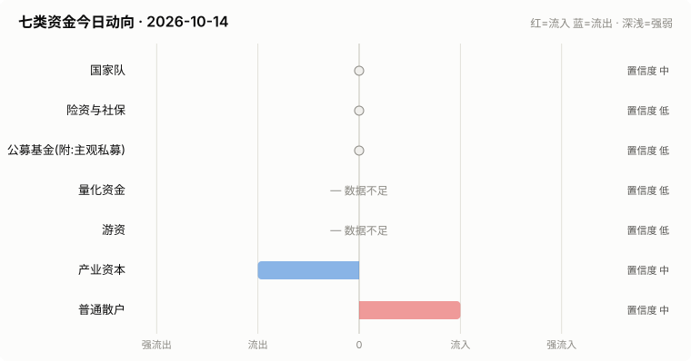

# A股资金动向日报 · 2026-10-14

> 本报告由公开数据自动生成。**方向结论按数据可得性标注置信度**:
> 高=每日硬数据(龙虎榜/公告/两融);中=每日代理指标(行为推断);低=仅低频或间接证据。

> ⚠️ 数据质量提示:本次运行保留了可用字段;缺失字段不补零,备用/历史值不视为当日值。各节中的警告包含具体来源和数据截至日期。

## 一、七类资金动向总览

| 参与者 | 动向 | 置信度 | 一句话解读 |
| --- | --- | --- | --- |
| 国家队 | → 中性 | 中 | 宽基ETF成交平稳,未见国家队明显动作。 |
| 险资与社保 | → 中性 | 低 | 无涉险资/社保公告;险资无每日数据,默认视为中性。 |
| 公募基金(附:主观私募) | → 中性 | 低 | ETF份额环比待历史累积;近7天新发权益基金 0亿份。 |
| 量化资金 | — 数据不足 | 低 | 指数数据缺失,无法计算小微盘成交占比。 |
| 游资 | — 数据不足 | 低 | 龙虎榜数据缺失。 |
| 产业资本 | ↓ 流出 | 中 | 净增持家数 -10;回购公告 8 家。 |
| 普通散户 | ↑ 流入 | 中 | 小单净流入 +92亿;沪市融资余额环比 -23亿。 |

**历史趋势(随每日运行更新)**

## 二、分项明细

### 2.1 国家队 — → 中性(置信度:中)

- 宽基ETF成交平稳(放量0只),未见明显护盘迹象。

**汇金系宽基ETF当日成交**

| 代码 | 名称 | 当日成交额 | 相对20日均量 | 涨跌幅 |
| --- | --- | --- | --- | --- |
| 510300 | 华泰柏瑞沪深300ETF | 46.8亿 | 1.32x | -0.34% |
| 510050 | 华夏上证50ETF | 15.3亿 | 1.01x | -0.51% |
| 510500 | 南方中证500ETF | 28.3亿 | 0.91x | -0.22% |
| 159919 | 嘉实沪深300ETF | 6.9亿 | 1.01x | -0.24% |
| 588000 | 华夏科创50ETF | 81.1亿 | 1.32x | +0.07% |
| 512100 | 南方中证1000ETF | 40.2亿 | 1.32x | -0.14% |

> ⚠️ 沪深300指数行情不可用,以 510300 ETF 涨跌幅代理。

### 2.2 险资与社保 — → 中性(置信度:低)

- 当日扫描持股变动公告 25 条,未发现涉险资/社保/举牌关键词。

> ⚠️ 险资/社保没有每日持仓披露:硬数据仅有季报十大流通股东与举牌公告,本节结论置信度恒为低,建议结合季报数据人工复核。

### 2.3 公募基金(附:主观私募) — → 中性(置信度:低)

- 全市场ETF总份额较上一交易日变动 +nan亿份(净赎回),以此作为公募被动端申赎代理。
- 近7天新成立权益类基金 2 只,合计募集 0.3亿份(反映公募增量资金入场节奏)。

**近7天新成立权益基金(募集前5)**

| 基金代码 | 基金简称 | 基金类型 | 募集份额 | 成立日期 |
| --- | --- | --- | --- | --- |
| 029014 | 永赢中证科创创业人工智能ETF发起联接A | 指数型-股票 | 0.16 | 2026-10-08 |
| 029015 | 永赢中证科创创业人工智能ETF发起联接C | 指数型-股票 | 0.16 | 2026-10-08 |

> ⚠️ 主观私募无每日公开持仓/仓位数据,通常仅有第三方月频仓位调查;本报告不对主观私募单独给出每日方向判断。

### 2.4 量化资金 — — 数据不足(置信度:低)

> ⚠️ 指数行情缺失:中证2000、上证综指、深证综指,量化活跃度无法计算。
> ⚠️ 量化动向为代理推断:公开数据无法区分具体量化策略,仅反映小微盘交易活跃度整体变化。

### 2.5 游资 — — 数据不足(置信度:低)

> ⚠️ 龙虎榜个股明细接口今日不可用。
> ⚠️ 活跃营业部接口今日不可用,席位识别缺失。

### 2.6 产业资本 — ↓ 流出(置信度:中)

- 当日增持公告 6 家,减持公告 16 家,净增持家数 -10。
- 当日更新回购公告 8 家,披露已回购金额合计 11.2亿。

> ⚠️ 股东增减持计数采用stock_notice_report 持股变动公告代理(非精确股东变动明细),数据截至 2026-10-14(报告日期 2026-10-14)。
> ⚠️ 大宗交易市场统计尚未更新到当日。
> ⚠️ 大宗交易个股明细接口今日不可用。

### 2.7 普通散户 — ↑ 流入(置信度:中)

- 全市场融资余额约 25172亿(沪 12892亿 + 深 12280亿),沪市环比 -22.7亿。
- 全市场小单(散户)净流入合计 91.8亿、主力净流入合计 -91.4亿(小单流入而主力流出,通常是散户接盘特征)(口径:大盘资金流接口(全市场代理))。
- 最近披露月份(2023-08)新增投资者 99.59 万户,环比 +9.4%(月频指标;该月度口径中登公司已停止披露,仅作历史参考)。

> ⚠️ 沪市融资余额采用stock_margin_sse,数据截至 2026-10-12(报告日期 2026-10-14,滞后 2 个日历日)。
> ⚠️ 沪市融资买入额采用stock_margin_sse,数据截至 2026-10-12(报告日期 2026-10-14,滞后 2 个日历日)。
> ⚠️ 深市融资余额采用stock_margin_szse,数据截至 2026-10-12(报告日期 2026-10-14,滞后 2 个日历日)。
> ⚠️ 深市融资买入额采用stock_margin_szse,数据截至 2026-10-12(报告日期 2026-10-14,滞后 2 个日历日)。
> ⚠️ 资金流采用大盘资金流接口(全市场代理),数据截至 2026-10-13(报告日期 2026-10-14,滞后 1 个日历日)。

## 三、个股杠杆监测

- 国家队(汇金系宽基ETF)历来是现金申购,不使用融资杠杆,因此没有可比的每日"国家队杠杆"数字;下面的杠杆水位与排行反映的主要是散户与游资的两融行为。
- 当日纳入统计的3254只个股中,291只融资余额占流通市值超过8%(阈值见 config.yaml);建议持有这类个股时使用更紧的止损比例(参考仓位/止损计算器,该工具支持按代码查询个股杠杆水位)。

**个股杠杆最集中(前15只,2026-10-12两融数据)**

| 代码 | 名称 | 融资买入占成交额% | 融资余额占流通市值% | 当日涨跌幅% | 当日振幅% |
| --- | --- | --- | --- | --- | --- |
| 603301 | 振德医疗 | 58.53 | 7.33 | 0.26 | 3.05 |
| 603668 | 天马科技 | 49.43 | 19.77 | -9.99 | 0.0 |
| 600163 | 中闽能源 | 48.75 | 3.59 | 0.36 | 3.63 |
| 002438 | 江苏神通 | 32.57 | 9.96 | 0.07 | 3.1 |
| 603418 | 友升股份 | 31.55 | 4.38 | -1.45 | 3.32 |
| 600987 | 航民股份 | 31.26 | 1.94 | -0.31 | 1.41 |
| 300006 | 莱美药业 | 31.14 | 8.56 | 0.3 | 12.5 |
| 002182 | 宝武镁业 | 30.98 | 7.49 | 0.72 | 4.85 |
| 688566 | 吉贝尔 | 30.29 | 3.9 | 0.63 | 2.92 |
| 002355 | 兴民智通 | 26.34 | 12.49 | 1.73 | 5.18 |
| 688526 | 科前生物 | 26.25 | 2.93 | -0.25 | 1.31 |
| 600284 | 浦东建设 | 25.92 | 6.24 | 0.19 | 1.93 |
| 600010 | 包钢股份 | 25.7 | 3.71 | 0.47 | 2.36 |
| 688225 | 亚信安全 | 25.55 | 2.42 | -1.79 | 3.71 |
| 688366 | 昊海生科 | 24.26 | 1.82 | -0.26 | 3.03 |

> ⚠️ 缺失:沪市成交额、深市成交额,市场整体杠杆水位无法计算。
> ⚠️ 实时行情快照主源不可用,本次排行采用腾讯备用源(数据截至 2026-10-14)。

## 四、数据说明与局限

- 国家队动向为行为推断(宽基ETF放量+指数走势组合),非官方口径;确认需等季报十大股东。
- 险资/社保、主观私募无每日公开数据,相关结论置信度恒为低。
- 量化动向以小微盘成交占比为代理,只反映整体活跃度,无法区分具体策略。
- 游资识别依赖 config.yaml 中的席位关键词表,存在漏配;拉萨系席位计为散户通道。
- 两融、龙虎榜等数据为 T+1 或盘后披露,个别接口更新时间不一。
- 个股杠杆排行剔除了流通市值过小的个股(阈值见 config.yaml),融资余额/买入额与当日行情存在披露时点差异,仅作参考,不构成个股推荐。
> ⚠️ 本报告含缺失、备用或历史快照数据;每条降级数字均按“数据截至 YYYY-MM-DD”标注真实新鲜度。

**本次运行的数据质量明细:**
- 国家队: 沪深300指数行情不可用,以 510300 ETF 涨跌幅代理。
- 量化资金: 指数行情缺失:中证2000、上证综指、深证综指,量化活跃度无法计算。
- 游资: 龙虎榜个股明细接口今日不可用。
- 游资: 活跃营业部接口今日不可用,席位识别缺失。
- 产业资本: 股东增减持计数采用stock_notice_report 持股变动公告代理(非精确股东变动明细),数据截至 2026-10-14(报告日期 2026-10-14)。
- 产业资本: 大宗交易市场统计尚未更新到当日。
- 产业资本: 大宗交易个股明细接口今日不可用。
- 普通散户: 沪市融资余额采用stock_margin_sse,数据截至 2026-10-12(报告日期 2026-10-14,滞后 2 个日历日)。
- 普通散户: 沪市融资买入额采用stock_margin_sse,数据截至 2026-10-12(报告日期 2026-10-14,滞后 2 个日历日)。
- 普通散户: 深市融资余额采用stock_margin_szse,数据截至 2026-10-12(报告日期 2026-10-14,滞后 2 个日历日)。
- 普通散户: 深市融资买入额采用stock_margin_szse,数据截至 2026-10-12(报告日期 2026-10-14,滞后 2 个日历日)。
- 普通散户: 资金流采用大盘资金流接口(全市场代理),数据截至 2026-10-13(报告日期 2026-10-14,滞后 1 个日历日)。
- 个股杠杆监测: 缺失:沪市成交额、深市成交额,市场整体杠杆水位无法计算。
- 个股杠杆监测: 实时行情快照主源不可用,本次排行采用腾讯备用源(数据截至 2026-10-14)。

**本次运行失败的数据源:**
- stock_sse_deal_daily: ValueError: Length mismatch: Expected axis has 1 elements, new values have 6 elements
- stock_szse_summary: AttributeError: 'float' object has no attribute 'replace'
- stock_lhb_detail_em: TypeError: 'NoneType' object is not subscriptable
- stock_lhb_hyyyb_em: TypeError: 'NoneType' object is not subscriptable
- stock_ggcg_em: TimeoutError: 
- stock_ggcg_em: TimeoutError: 
- stock_dzjy_mrmx: TypeError: 'NoneType' object is not subscriptable
- stock_margin_szse: ValueError: Length mismatch: Expected axis has 0 elements, new values have 6 elements
- stock_margin_szse: ValueError: Length mismatch: Expected axis has 0 elements, new values have 6 elements
- stock_individual_fund_flow_rank: TimeoutError: 
- stock_margin_detail_sse: ValueError: Length mismatch: Expected axis has 0 elements, new values have 13 elements
- stock_margin_detail_sse: ValueError: Length mismatch: Expected axis has 0 elements, new values have 13 elements
- stock_zh_a_spot_em: TimeoutError: 
