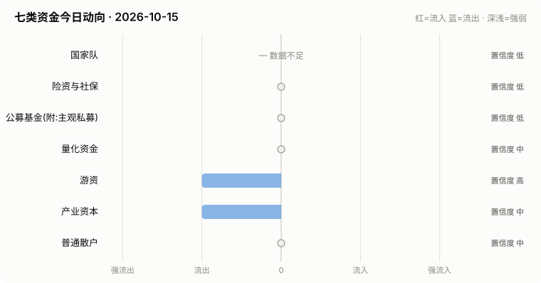

# A股资金动向日报 · 2026-10-15

> 本报告由公开数据自动生成。**方向结论按数据可得性标注置信度**:
> 高=每日硬数据(龙虎榜/公告/两融);中=每日代理指标(行为推断);低=仅低频或间接证据。

> ⚠️ 数据质量提示:本次运行保留了可用字段;缺失字段不补零,备用/历史值不视为当日值。各节中的警告包含具体来源和数据截至日期。

## 一、七类资金动向总览

| 参与者 | 动向 | 置信度 | 一句话解读 |
| --- | --- | --- | --- |
| 国家队 | — 数据不足 | 低 | ETF数据缺失,无法判断。 |
| 险资与社保 | → 中性 | 低 | 无涉险资/社保公告;险资无每日数据,默认视为中性。 |
| 公募基金(附:主观私募) | → 中性 | 低 | ETF份额环比待历史累积;近7天新发权益基金 1亿份。 |
| 量化资金 | → 中性 | 中 | 小微盘成交占比较20日均值偏离 -0.4pp,代理量化策略活跃度变化。 |
| 游资 | ↓ 流出 | 高 | 知名游资席位 3 个上榜,合计净买入 -1.0亿。 |
| 产业资本 | ↓ 流出 | 中 | 净增持家数 -9;回购公告 14 家;大宗溢价成交占比 10%。 |
| 普通散户 | → 中性 | 中 | 小单净流入 +484亿;沪市融资余额环比 -60亿。 |

**历史趋势(随每日运行更新)**

## 二、分项明细

### 2.1 国家队 — — 数据不足(置信度:低)

> ⚠️ ETF快照数据缺失,本节无法判断。

### 2.2 险资与社保 — → 中性(置信度:低)

- 当日扫描持股变动公告 34 条,未发现涉险资/社保/举牌关键词。

> ⚠️ 险资/社保没有每日持仓披露:硬数据仅有季报十大流通股东与举牌公告,本节结论置信度恒为低,建议结合季报数据人工复核。

### 2.3 公募基金(附:主观私募) — → 中性(置信度:低)

- 近7天新成立权益类基金 6 只,合计募集 1.3亿份(反映公募增量资金入场节奏)。

**近7天新成立权益基金(募集前5)**

| 基金代码 | 基金简称 | 基金类型 | 募集份额 | 成立日期 |
| --- | --- | --- | --- | --- |
| 028767 | 东财资源智选混合发起式A | 混合型-偏股 | 0.25 | 2026-10-09 |
| 028774 | 东财资源智选混合发起式C | 混合型-偏股 | 0.25 | 2026-10-09 |
| 028937 | 华泰柏瑞中证科创创业人工智能ETF发起式联接C | 指数型-股票 | 0.24 | 2026-10-09 |
| 028936 | 华泰柏瑞中证科创创业人工智能ETF发起式联接A | 指数型-股票 | 0.24 | 2026-10-09 |
| 029015 | 永赢中证科创创业人工智能ETF发起联接C | 指数型-股票 | 0.16 | 2026-10-08 |

> ⚠️ ETF实时快照接口今日不可用。
> ⚠️ 主观私募无每日公开持仓/仓位数据,通常仅有第三方月频仓位调查;本报告不对主观私募单独给出每日方向判断。

### 2.4 量化资金 — → 中性(置信度:中)

- 全市场成交 16350亿,其中中证2000成交 3370亿,小微盘成交占比 20.6%,较20日均值(21.0%)偏离 -0.4个百分点。
- 中证2000当日 -3.30%。小微盘成交占比明显上升通常对应量化(高频/微盘策略)活跃度上升,反之为降杠杆或撤退。

> ⚠️ 量化动向为代理推断:公开数据无法区分具体量化策略,仅反映小微盘交易活跃度整体变化。

### 2.5 游资 — ↓ 流出(置信度:高)

- 拉萨系(散户通道)席位当日买入 6.3亿,净买 1.8亿(此项同时作为散户情绪参考)。

**当日龙虎榜净买额前8个股**

| 代码 | 名称 | 收盘价 | 涨跌幅 | 龙虎榜净买额 | 上榜原因 |
| --- | --- | --- | --- | --- | --- |
| 600869 | 远东股份 | 18.08 | +6.79% | 2.6亿 | 有价格涨跌幅限制的日价格振幅达到15%的前五只证券 |
| 002945 | 华林证券 | 15.39 | +10.01% | 1.9亿 | 日涨幅偏离值达到7%的前5只证券 |
| 600721 | 百花医药 | 12.05 | +10.05% | 1.9亿 | 有价格涨跌幅限制的日收盘价格涨幅偏离值达到7%的前五只证券 |
| 301569 | 联亚药业 | 35.12 | +401.71% | 1.4亿 | 无价格涨跌幅限制的证券 |
| 603230 | 内蒙新华 | 14.52 | +10.00% | 1.1亿 | 有价格涨跌幅限制的日价格振幅达到15%的前五只证券 |
| 300111 | 向日葵 | 3.71 | +20.06% | 1.1亿 | 日涨幅达到15%的前5只证券 |
| 000892 | 欢瑞世纪 | 5.45 | +6.24% | 1.1亿 | 日换手率达到20%的前5只证券 |
| 301282 | 金禄电子 | 49.92 | +20.00% | 1.0亿 | 连续三个交易日内，涨幅偏离值累计达到30%的证券 |

**知名游资席位当日动向**

| 营业部名称 | 买入 | 卖出 | 净额 | 买入股票 |
| --- | --- | --- | --- | --- |
| 华泰证券股份有限公司深圳益田路荣超商务中心证券营业部 | 0.0亿 | 0.2亿 | -0.2亿 | 百瑞吉 |
| 华鑫证券有限责任公司上海分公司 | — | 0.2亿 | -0.2亿 | 澳弘转债 新华文轩 |
| 中国银河证券股份有限公司绍兴鲁迅中路证券营业部 | — | 0.6亿 | -0.6亿 | 海南橡胶 |

### 2.6 产业资本 — ↓ 流出(置信度:中)

- 当日增持公告 11 家,减持公告 20 家,净增持家数 -9。
- 当日更新回购公告 14 家,披露已回购金额合计 12.5亿。
- 大宗交易成交总额 11.8亿,其中溢价成交占比 10.3%(溢价占比高通常代表主动接盘意愿强)。

> ⚠️ 股东增减持计数采用stock_notice_report 持股变动公告代理(非精确股东变动明细),数据截至 2026-10-15(报告日期 2026-10-15)。

### 2.7 普通散户 — → 中性(置信度:中)

- 全市场融资余额约 24975亿(沪 12801亿 + 深 12174亿),沪市环比 -59.9亿。
- 全市场小单(散户)净流入合计 483.8亿、主力净流入合计 -635.3亿(小单流入而主力流出,通常是散户接盘特征)(口径:大盘资金流接口(全市场代理))。
- 最近披露月份(2023-08)新增投资者 99.59 万户,环比 +9.4%(月频指标;该月度口径中登公司已停止披露,仅作历史参考)。

> ⚠️ 沪市融资余额采用stock_margin_sse,数据截至 2026-10-14(报告日期 2026-10-15,滞后 1 个日历日)。
> ⚠️ 沪市融资买入额采用stock_margin_sse,数据截至 2026-10-14(报告日期 2026-10-15,滞后 1 个日历日)。
> ⚠️ 深市融资余额采用stock_margin_szse,数据截至 2026-10-14(报告日期 2026-10-15,滞后 1 个日历日)。
> ⚠️ 深市融资买入额采用stock_margin_szse,数据截至 2026-10-14(报告日期 2026-10-15,滞后 1 个日历日)。
> ⚠️ 资金流采用大盘资金流接口(全市场代理),数据截至 2026-10-15(报告日期 2026-10-15)。

## 三、个股杠杆监测

- 当日两融资金参与度(融资买入额/两市成交额)约 6.87%,较20日均值(9.0%)偏离 -2.1个百分点(比例越高说明当日交易中加杠杆买入的比重越大,市场波动风险通常也更高)。
- 国家队(汇金系宽基ETF)历来是现金申购,不使用融资杠杆,因此没有可比的每日"国家队杠杆"数字;下面的杠杆水位与排行反映的主要是散户与游资的两融行为。
- 当日纳入统计的3228只个股中,361只融资余额占流通市值超过8%(阈值见 config.yaml);建议持有这类个股时使用更紧的止损比例(参考仓位/止损计算器,该工具支持按代码查询个股杠杆水位)。

**个股杠杆最集中(前15只,2026-10-14两融数据)**

| 代码 | 名称 | 融资买入占成交额% | 融资余额占流通市值% | 当日涨跌幅% | 当日振幅% |
| --- | --- | --- | --- | --- | --- |
| 600693 | 东百集团 | 209.7 | 1.59 | -10.01 | 0.0 |
| 600305 | 恒顺醋业 | 44.6 | 2.47 | -1.44 | 2.02 |
| 002815 | 崇达技术 | 36.18 | 2.15 | 9.98 | 0.0 |
| 688280 | 精进电动 | 33.96 | 7.49 | -4.66 | 4.03 |
| 601228 | 广州港 | 33.24 | 1.12 | -2.82 | 3.45 |
| 603085 | 天成自控 | 29.33 | 6.21 | -2.42 | 3.99 |
| 000707 | 双环科技 | 29.03 | 6.09 | -3.1 | 3.1 |
| 002452 | 长高电气 | 28.31 | 4.68 | -2.04 | 2.65 |
| 002355 | 兴民智通 | 28.04 | 13.74 | -2.87 | 2.65 |
| 301273 | 瑞晨环保 | 26.73 | 2.76 | -0.25 | 5.85 |
| 688015 | 交控科技 | 25.51 | 3.59 | -3.68 | 2.82 |
| 300978 | 东箭科技 | 24.33 | 6.56 | -1.75 | 2.1 |
| 688602 | 康鹏科技 | 24.07 | 3.69 | -2.15 | 1.84 |
| 603301 | 振德医疗 | 23.87 | 7.63 | -2.98 | 3.57 |
| 300989 | 蕾奥规划 | 23.23 | 11.93 | 2.97 | 8.35 |

> ⚠️ 沪市融资买入额采用stock_margin_sse,数据截至 2026-10-14(报告日期 2026-10-15,滞后 1 个日历日)。
> ⚠️ 深市融资买入额采用stock_margin_szse,数据截至 2026-10-14(报告日期 2026-10-15,滞后 1 个日历日)。
> ⚠️ 实时行情快照主源不可用,本次排行采用腾讯备用源(数据截至 2026-10-15)。

## 四、数据说明与局限

- 国家队动向为行为推断(宽基ETF放量+指数走势组合),非官方口径;确认需等季报十大股东。
- 险资/社保、主观私募无每日公开数据,相关结论置信度恒为低。
- 量化动向以小微盘成交占比为代理,只反映整体活跃度,无法区分具体策略。
- 游资识别依赖 config.yaml 中的席位关键词表,存在漏配;拉萨系席位计为散户通道。
- 两融、龙虎榜等数据为 T+1 或盘后披露,个别接口更新时间不一。
- 个股杠杆排行剔除了流通市值过小的个股(阈值见 config.yaml),融资余额/买入额与当日行情存在披露时点差异,仅作参考,不构成个股推荐。
> ⚠️ 本报告含缺失、备用或历史快照数据;每条降级数字均按“数据截至 YYYY-MM-DD”标注真实新鲜度。

**本次运行的数据质量明细:**
- 国家队: ETF快照数据缺失,本节无法判断。
- 公募基金(附:主观私募): ETF实时快照接口今日不可用。
- 产业资本: 股东增减持计数采用stock_notice_report 持股变动公告代理(非精确股东变动明细),数据截至 2026-10-15(报告日期 2026-10-15)。
- 普通散户: 沪市融资余额采用stock_margin_sse,数据截至 2026-10-14(报告日期 2026-10-15,滞后 1 个日历日)。
- 普通散户: 沪市融资买入额采用stock_margin_sse,数据截至 2026-10-14(报告日期 2026-10-15,滞后 1 个日历日)。
- 普通散户: 深市融资余额采用stock_margin_szse,数据截至 2026-10-14(报告日期 2026-10-15,滞后 1 个日历日)。
- 普通散户: 深市融资买入额采用stock_margin_szse,数据截至 2026-10-14(报告日期 2026-10-15,滞后 1 个日历日)。
- 普通散户: 资金流采用大盘资金流接口(全市场代理),数据截至 2026-10-15(报告日期 2026-10-15)。
- 个股杠杆监测: 沪市融资买入额采用stock_margin_sse,数据截至 2026-10-14(报告日期 2026-10-15,滞后 1 个日历日)。
- 个股杠杆监测: 深市融资买入额采用stock_margin_szse,数据截至 2026-10-14(报告日期 2026-10-15,滞后 1 个日历日)。
- 个股杠杆监测: 实时行情快照主源不可用,本次排行采用腾讯备用源(数据截至 2026-10-15)。

**本次运行失败的数据源:**
- fund_etf_spot_em: HTTPError: 502 Server Error: Bad Gateway for url: https://push2delay.eastmoney.com/api/qt/clist/get?pn=1&pz=100&po=1&np=1&ut=bd1d9d
- stock_ggcg_em: TimeoutError: 
- stock_ggcg_em: TimeoutError: 
- stock_margin_szse: ValueError: Length mismatch: Expected axis has 0 elements, new values have 6 elements
- stock_individual_fund_flow_rank: JSONDecodeError: Expecting value: line 1 column 1 (char 0)
- stock_margin_detail_sse: ValueError: Length mismatch: Expected axis has 0 elements, new values have 13 elements
- stock_zh_a_spot_em: ConnectionError: ('Connection aborted.', RemoteDisconnected('Remote end closed connection without response'))
