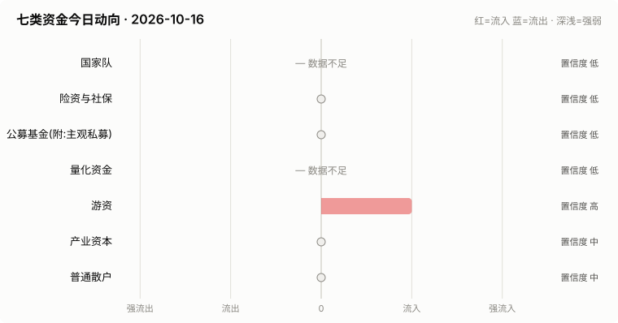

# A股资金动向日报 · 2026-10-16

> 本报告由公开数据自动生成。**方向结论按数据可得性标注置信度**:
> 高=每日硬数据(龙虎榜/公告/两融);中=每日代理指标(行为推断);低=仅低频或间接证据。

> ⚠️ 数据质量提示:本次运行保留了可用字段;缺失字段不补零,备用/历史值不视为当日值。各节中的警告包含具体来源和数据截至日期。

## 一、七类资金动向总览

| 参与者 | 动向 | 置信度 | 一句话解读 |
| --- | --- | --- | --- |
| 国家队 | — 数据不足 | 低 | ETF数据缺失,无法判断。 |
| 险资与社保 | → 中性 | 低 | 无涉险资/社保公告;险资无每日数据,默认视为中性。 |
| 公募基金(附:主观私募) | → 中性 | 低 | ETF份额环比待历史累积;近7天新发权益基金 2亿份。 |
| 量化资金 | — 数据不足 | 低 | 指数数据缺失,无法计算小微盘成交占比。 |
| 游资 | ↑ 流入 | 高 | 知名游资席位 2 个上榜,合计净买入 +1.6亿。 |
| 产业资本 | → 中性 | 中 | 净增持家数 +5;回购公告 24 家;大宗溢价成交占比 0%。 |
| 普通散户 | → 中性 | 中 | 小单净流入 +484亿;沪市融资余额环比 -60亿。 |

**历史趋势(随每日运行更新)**

## 二、分项明细

### 2.1 国家队 — — 数据不足(置信度:低)

> ⚠️ ETF快照数据缺失,本节无法判断。

### 2.2 险资与社保 — → 中性(置信度:低)

- 当日扫描持股变动公告 20 条,未发现涉险资/社保/举牌关键词。

> ⚠️ 险资/社保没有每日持仓披露:硬数据仅有季报十大流通股东与举牌公告,本节结论置信度恒为低,建议结合季报数据人工复核。

### 2.3 公募基金(附:主观私募) — → 中性(置信度:低)

- 近7天新成立权益类基金 10 只,合计募集 1.7亿份(反映公募增量资金入场节奏)。

**近7天新成立权益基金(募集前5)**

| 基金代码 | 基金简称 | 基金类型 | 募集份额 | 成立日期 |
| --- | --- | --- | --- | --- |
| 028774 | 东财资源智选混合发起式C | 混合型-偏股 | 0.25 | 2026-10-09 |
| 028767 | 东财资源智选混合发起式A | 混合型-偏股 | 0.25 | 2026-10-09 |
| 028937 | 华泰柏瑞中证科创创业人工智能ETF发起式联接C | 指数型-股票 | 0.24 | 2026-10-09 |
| 028936 | 华泰柏瑞中证科创创业人工智能ETF发起式联接A | 指数型-股票 | 0.24 | 2026-10-09 |
| 028927 | 大成中证有色金属矿业主题指数发起式C | 指数型-股票 | 0.12 | 2026-10-14 |

> ⚠️ ETF实时快照接口今日不可用。
> ⚠️ 主观私募无每日公开持仓/仓位数据,通常仅有第三方月频仓位调查;本报告不对主观私募单独给出每日方向判断。

### 2.4 量化资金 — — 数据不足(置信度:低)

> ⚠️ 指数行情缺失:上证综指,量化活跃度无法计算。
> ⚠️ 量化动向为代理推断:公开数据无法区分具体量化策略,仅反映小微盘交易活跃度整体变化。

### 2.5 游资 — ↑ 流入(置信度:高)

- 拉萨系(散户通道)席位当日买入 2.8亿,净买 0.5亿(此项同时作为散户情绪参考)。

**当日龙虎榜净买额前8个股**

| 代码 | 名称 | 收盘价 | 涨跌幅 | 龙虎榜净买额 | 上榜原因 |
| --- | --- | --- | --- | --- | --- |
| 603259 | 药明康德 | 144.3 | -6.60% | 14.4亿 | 有价格涨跌幅限制的日价格振幅达到15%的前五只证券 |
| 001696 | 宗申动力 | 15.87 | +9.98% | 1.5亿 | 日涨幅偏离值达到7%的前5只证券 |
| 000887 | 中鼎股份 | 17.72 | +9.99% | 1.5亿 | 日涨幅偏离值达到7%的前5只证券 |
| 603067 | 振华股份 | 38.0 | -8.17% | 1.5亿 | 有价格涨跌幅限制的日价格振幅达到15%的前五只证券 |
| 300045 | 华力创通 | 12.7 | +20.04% | 1.1亿 | 日涨幅达到15%的前5只证券 |
| 600802 | 福建水泥 | 6.78 | +10.06% | 0.9亿 | 有价格涨跌幅限制的日收盘价格涨幅偏离值达到7%的前五只证券 |
| 002531 | 天顺风能 | 7.41 | +9.94% | 0.9亿 | 日涨幅偏离值达到7%的前5只证券 |
| 603999 | 读者传媒 | 8.38 | +9.97% | 0.8亿 | 非S证券连续三个交易日内收盘价格涨幅偏离值累计达到20%的证券 |

**知名游资席位当日动向**

| 营业部名称 | 买入 | 卖出 | 净额 | 买入股票 |
| --- | --- | --- | --- | --- |
| 国盛证券股份有限公司宁波桑田路证券营业部 | 1.3亿 | 0.1亿 | 1.3亿 | 莱美药业 |
| 中国银河证券股份有限公司绍兴鲁迅中路证券营业部 | 0.3亿 | 0.0亿 | 0.3亿 | 华力创通 |

### 2.6 产业资本 — → 中性(置信度:中)

- 当日增持公告 12 家,减持公告 7 家,净增持家数 +5。
- 当日更新回购公告 24 家,披露已回购金额合计 9.6亿。
- 大宗交易成交总额 45.5亿,其中溢价成交占比 0.2%(溢价占比高通常代表主动接盘意愿强)。

> ⚠️ 股东增减持计数采用stock_notice_report 持股变动公告代理(非精确股东变动明细),数据截至 2026-10-16(报告日期 2026-10-16)。

### 2.7 普通散户 — → 中性(置信度:中)

- 全市场融资余额约 24808亿(沪 12801亿 + 深 12007亿),沪市环比 -59.9亿。
- 全市场小单(散户)净流入合计 483.8亿、主力净流入合计 -635.3亿(小单流入而主力流出,通常是散户接盘特征)(口径:历史资金流快照)。
- 最近披露月份(2023-08)新增投资者 99.59 万户,环比 +9.4%(月频指标;该月度口径中登公司已停止披露,仅作历史参考)。

> ⚠️ 沪市融资余额采用历史两融快照,数据截至 2026-10-15(报告日期 2026-10-16,滞后 1 个日历日)。
> ⚠️ 沪市融资买入额采用历史两融快照,数据截至 2026-10-15(报告日期 2026-10-16,滞后 1 个日历日)。
> ⚠️ 深市融资余额采用stock_margin_szse,数据截至 2026-10-15(报告日期 2026-10-16,滞后 1 个日历日)。
> ⚠️ 深市融资买入额采用stock_margin_szse,数据截至 2026-10-15(报告日期 2026-10-16,滞后 1 个日历日)。
> ⚠️ 资金流采用历史资金流快照,数据截至 2026-10-15(报告日期 2026-10-16,滞后 1 个日历日)。

## 三、个股杠杆监测

- 国家队(汇金系宽基ETF)历来是现金申购,不使用融资杠杆,因此没有可比的每日"国家队杠杆"数字;下面的杠杆水位与排行反映的主要是散户与游资的两融行为。
- 当日纳入统计的1652只个股中,228只融资余额占流通市值超过8%(阈值见 config.yaml);建议持有这类个股时使用更紧的止损比例(参考仓位/止损计算器,该工具支持按代码查询个股杠杆水位)。

**个股杠杆最集中(前15只,2026-10-15两融数据)**

| 代码 | 名称 | 融资买入占成交额% | 融资余额占流通市值% | 当日涨跌幅% | 当日振幅% |
| --- | --- | --- | --- | --- | --- |
| 301059 | 金三江 | 35.94 | 1.43 | 0.24 | 3.0 |
| 301305 | 朗坤科技 | 28.97 | 7.39 | 1.43 | 3.25 |
| 000612 | 焦作万方 | 27.8 | 7.76 | 0.94 | 2.18 |
| 000778 | 新兴铸管 | 27.63 | 5.58 | 0.55 | 1.66 |
| 002539 | 云图控股 | 26.43 | 4.99 | 1.49 | 2.71 |
| 000408 | 藏格矿业 | 26.08 | 1.8 | 1.18 | 2.8 |
| 001359 | 平安电工 | 25.41 | 8.23 | 3.66 | 8.81 |
| 000933 | 神火股份 | 25.15 | 3.61 | 1.47 | 2.58 |
| 002120 | 韵达股份 | 25.01 | 3.2 | 0.15 | 1.82 |
| 002010 | 传化智联 | 24.76 | 4.32 | 0.45 | 2.48 |
| 000012 | 南  玻Ａ | 23.91 | 6.5 | 0.28 | 1.42 |
| 000807 | 云铝股份 | 23.87 | 2.38 | 0.72 | 2.48 |
| 000709 | 河钢股份 | 23.62 | 3.65 | 2.0 | 2.5 |
| 000531 | 穗恒运Ａ | 23.04 | 3.78 | 0.19 | 1.3 |
| 301220 | 亚香股份 | 22.47 | 11.59 | -9.33 | 12.01 |

> ⚠️ 缺失:沪市成交额,市场整体杠杆水位无法计算。
> ⚠️ 实时行情快照主源不可用,本次排行采用腾讯备用源(数据截至 2026-10-16)。
> ⚠️ 个股两融明细缺失沪市,排行仅使用可用市场明细(数据截至 2026-10-15)。

## 四、数据说明与局限

- 国家队动向为行为推断(宽基ETF放量+指数走势组合),非官方口径;确认需等季报十大股东。
- 险资/社保、主观私募无每日公开数据,相关结论置信度恒为低。
- 量化动向以小微盘成交占比为代理,只反映整体活跃度,无法区分具体策略。
- 游资识别依赖 config.yaml 中的席位关键词表,存在漏配;拉萨系席位计为散户通道。
- 两融、龙虎榜等数据为 T+1 或盘后披露,个别接口更新时间不一。
- 个股杠杆排行剔除了流通市值过小的个股(阈值见 config.yaml),融资余额/买入额与当日行情存在披露时点差异,仅作参考,不构成个股推荐。
> ⚠️ 本报告含缺失、备用或历史快照数据;每条降级数字均按“数据截至 YYYY-MM-DD”标注真实新鲜度。

**本次运行的数据质量明细:**
- 国家队: ETF快照数据缺失,本节无法判断。
- 公募基金(附:主观私募): ETF实时快照接口今日不可用。
- 量化资金: 指数行情缺失:上证综指,量化活跃度无法计算。
- 产业资本: 股东增减持计数采用stock_notice_report 持股变动公告代理(非精确股东变动明细),数据截至 2026-10-16(报告日期 2026-10-16)。
- 普通散户: 沪市融资余额采用历史两融快照,数据截至 2026-10-15(报告日期 2026-10-16,滞后 1 个日历日)。
- 普通散户: 沪市融资买入额采用历史两融快照,数据截至 2026-10-15(报告日期 2026-10-16,滞后 1 个日历日)。
- 普通散户: 深市融资余额采用stock_margin_szse,数据截至 2026-10-15(报告日期 2026-10-16,滞后 1 个日历日)。
- 普通散户: 深市融资买入额采用stock_margin_szse,数据截至 2026-10-15(报告日期 2026-10-16,滞后 1 个日历日)。
- 普通散户: 资金流采用历史资金流快照,数据截至 2026-10-15(报告日期 2026-10-16,滞后 1 个日历日)。
- 个股杠杆监测: 缺失:沪市成交额,市场整体杠杆水位无法计算。
- 个股杠杆监测: 实时行情快照主源不可用,本次排行采用腾讯备用源(数据截至 2026-10-16)。
- 个股杠杆监测: 个股两融明细缺失沪市,排行仅使用可用市场明细(数据截至 2026-10-15)。

**本次运行失败的数据源:**
- fund_etf_spot_em: HTTPError: 502 Server Error: Bad Gateway for url: https://push2delay.eastmoney.com/api/qt/clist/get?pn=1&pz=100&po=1&np=1&ut=bd1d9d
- stock_sse_deal_daily: JSONDecodeError: Expecting value: line 1 column 1 (char 0)
- stock_ggcg_em: TimeoutError: 
- stock_ggcg_em: TimeoutError: 
- stock_margin_sse: JSONDecodeError: Expecting value: line 1 column 1 (char 0)
- stock_margin_szse: ValueError: Length mismatch: Expected axis has 0 elements, new values have 6 elements
- stock_individual_fund_flow_rank: JSONDecodeError: Expecting value: line 1 column 1 (char 0)
- stock_market_fund_flow: ConnectionError: ('Connection aborted.', RemoteDisconnected('Remote end closed connection without response'))
- stock_margin_detail_sse: JSONDecodeError: Expecting value: line 1 column 1 (char 0)
- stock_margin_detail_sse: JSONDecodeError: Expecting value: line 1 column 1 (char 0)
- stock_zh_a_spot_em: ConnectionError: ('Connection aborted.', RemoteDisconnected('Remote end closed connection without response'))
