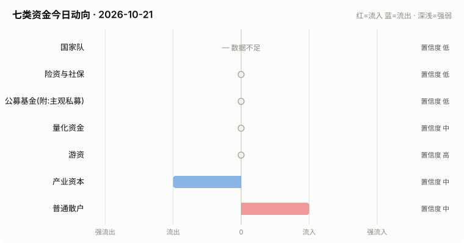

# A股资金动向日报 · 2026-10-21

> 本报告由公开数据自动生成。**方向结论按数据可得性标注置信度**:
> 高=每日硬数据(龙虎榜/公告/两融);中=每日代理指标(行为推断);低=仅低频或间接证据。

> ⚠️ 数据质量提示:本次运行保留了可用字段;缺失字段不补零,备用/历史值不视为当日值。各节中的警告包含具体来源和数据截至日期。

## 一、七类资金动向总览

| 参与者 | 动向 | 置信度 | 一句话解读 |
| --- | --- | --- | --- |
| 国家队 | — 数据不足 | 低 | ETF数据缺失,无法判断。 |
| 险资与社保 | → 中性 | 低 | 无涉险资/社保公告;险资无每日数据,默认视为中性。 |
| 公募基金(附:主观私募) | → 中性 | 低 | ETF份额环比待历史累积;近7天新发权益基金 0亿份。 |
| 量化资金 | → 中性 | 中 | 小微盘成交占比较20日均值偏离 +0.8pp,代理量化策略活跃度变化。 |
| 游资 | → 中性 | 高 | 知名游资席位 3 个上榜,合计净买入 +0.4亿。 |
| 产业资本 | ↓ 流出 | 中 | 净增持家数 -11;回购公告 14 家;大宗溢价成交占比 6%。 |
| 普通散户 | ↑ 流入 | 中 | 小单净流入 +484亿;沪市融资余额环比 -11亿。 |

**历史趋势(随每日运行更新)**

## 二、分项明细

### 2.1 国家队 — — 数据不足(置信度:低)

> ⚠️ ETF快照数据缺失,本节无法判断。

### 2.2 险资与社保 — → 中性(置信度:低)

- 当日扫描持股变动公告 30 条,未发现涉险资/社保/举牌关键词。

> ⚠️ 险资/社保没有每日持仓披露:硬数据仅有季报十大流通股东与举牌公告,本节结论置信度恒为低,建议结合季报数据人工复核。

### 2.3 公募基金(附:主观私募) — → 中性(置信度:低)

- 近7天新成立权益类基金 4 只,合计募集 0.5亿份(反映公募增量资金入场节奏)。

**近7天新成立权益基金(募集前5)**

| 基金代码 | 基金简称 | 基金类型 | 募集份额 | 成立日期 |
| --- | --- | --- | --- | --- |
| 028927 | 大成中证有色金属矿业主题指数发起式C | 指数型-股票 | 0.12 | 2026-10-14 |
| 028926 | 大成中证有色金属矿业主题指数发起式A | 指数型-股票 | 0.12 | 2026-10-14 |
| 028376 | 华宝中证全指家用电器ETF发起式联接A | 指数型-股票 | 0.11 | 2026-10-14 |
| 028377 | 华宝中证全指家用电器ETF发起式联接C | 指数型-股票 | 0.11 | 2026-10-14 |

> ⚠️ ETF实时快照接口今日不可用。
> ⚠️ 主观私募无每日公开持仓/仓位数据,通常仅有第三方月频仓位调查;本报告不对主观私募单独给出每日方向判断。

### 2.4 量化资金 — → 中性(置信度:中)

- 全市场成交 14315亿,其中中证2000成交 3163亿,小微盘成交占比 22.1%,较20日均值(21.3%)偏离 +0.8个百分点。
- 中证2000当日 -0.02%。小微盘成交占比明显上升通常对应量化(高频/微盘策略)活跃度上升,反之为降杠杆或撤退。

> ⚠️ 量化动向为代理推断:公开数据无法区分具体量化策略,仅反映小微盘交易活跃度整体变化。

### 2.5 游资 — → 中性(置信度:高)

- 拉萨系(散户通道)席位当日买入 2.8亿,净买 0.6亿(此项同时作为散户情绪参考)。

**当日龙虎榜净买额前8个股**

| 代码 | 名称 | 收盘价 | 涨跌幅 | 龙虎榜净买额 | 上榜原因 |
| --- | --- | --- | --- | --- | --- |
| 300115 | 长盈精密 | 26.41 | +7.05% | 3.8亿 | 连续三个交易日内，涨幅偏离值累计达到30%的证券 |
| 603341 | 龙旗科技 | 40.31 | +5.36% | 3.1亿 | 非S证券连续三个交易日内收盘价格涨幅偏离值累计达到20%的证券 |
| 301486 | 致尚科技 | 209.72 | +17.12% | 3.1亿 | 日涨幅达到15%的前5只证券 |
| 002181 | 粤传媒 | 11.14 | +9.97% | 2.5亿 | 连续三个交易日内，涨幅偏离值累计达到20%的证券 |
| 300296 | 利亚德 | 5.63 | +20.04% | 2.4亿 | 日涨幅达到15%的前5只证券 |
| 300006 | 莱美药业 | 9.3 | +20.00% | 2.4亿 | 日涨幅达到15%的前5只证券 |
| 002639 | 雪人集团 | 15.18 | +10.00% | 2.1亿 | 日涨幅偏离值达到7%的前5只证券 |
| 002792 | 通宇通讯 | 32.09 | +10.01% | 1.9亿 | 连续三个交易日内，涨幅偏离值累计达到20%的证券 |

**知名游资席位当日动向**

| 营业部名称 | 买入 | 卖出 | 净额 | 买入股票 |
| --- | --- | --- | --- | --- |
| 东吴证券股份有限公司苏州西北街证券营业部 | 0.2亿 | 0.0亿 | 0.2亿 | 慕思股份 沈鼓集团 |
| 国盛证券股份有限公司宁波桑田路证券营业部 | 0.2亿 | — | 0.2亿 | 沈鼓集团 |
| 华鑫证券有限责任公司上海分公司 | 0.1亿 | 0.0亿 | 0.1亿 | 泰尔股份 |

### 2.6 产业资本 — ↓ 流出(置信度:中)

- 当日增持公告 9 家,减持公告 20 家,净增持家数 -11。
- 当日更新回购公告 14 家,披露已回购金额合计 8.7亿。
- 大宗交易成交总额 13.5亿,其中溢价成交占比 5.8%(溢价占比高通常代表主动接盘意愿强)。

> ⚠️ 股东增减持计数采用stock_notice_report 持股变动公告代理(非精确股东变动明细),数据截至 2026-10-21(报告日期 2026-10-21)。

### 2.7 普通散户 — ↑ 流入(置信度:中)

- 全市场融资余额约 24434亿(沪 12580亿 + 深 11854亿),沪市环比 -10.7亿。
- 全市场小单(散户)净流入合计 483.8亿、主力净流入合计 -635.3亿(小单流入而主力流出,通常是散户接盘特征)(口径:历史资金流快照)。
- 最近披露月份(2023-08)新增投资者 99.59 万户,环比 +9.4%(月频指标;该月度口径中登公司已停止披露,仅作历史参考)。

> ⚠️ 沪市融资余额采用stock_margin_sse,数据截至 2026-10-20(报告日期 2026-10-21,滞后 1 个日历日)。
> ⚠️ 沪市融资买入额采用stock_margin_sse,数据截至 2026-10-20(报告日期 2026-10-21,滞后 1 个日历日)。
> ⚠️ 深市融资余额采用stock_margin_szse,数据截至 2026-10-20(报告日期 2026-10-21,滞后 1 个日历日)。
> ⚠️ 深市融资买入额采用stock_margin_szse,数据截至 2026-10-20(报告日期 2026-10-21,滞后 1 个日历日)。
> ⚠️ 资金流采用历史资金流快照,数据截至 2026-10-20(报告日期 2026-10-21,滞后 1 个日历日)。

## 三、个股杠杆监测

- 当日两融资金参与度(融资买入额/两市成交额)约 8.41%,较20日均值(8.7%)偏离 -0.3个百分点(比例越高说明当日交易中加杠杆买入的比重越大,市场波动风险通常也更高)。
- 国家队(汇金系宽基ETF)历来是现金申购,不使用融资杠杆,因此没有可比的每日"国家队杠杆"数字;下面的杠杆水位与排行反映的主要是散户与游资的两融行为。
- 当日纳入统计的3230只个股中,293只融资余额占流通市值超过8%(阈值见 config.yaml);建议持有这类个股时使用更紧的止损比例(参考仓位/止损计算器,该工具支持按代码查询个股杠杆水位)。

**个股杠杆最集中(前15只,2026-10-20两融数据)**

| 代码 | 名称 | 融资买入占成交额% | 融资余额占流通市值% | 当日涨跌幅% | 当日振幅% |
| --- | --- | --- | --- | --- | --- |
| 600894 | 广日股份 | 43.78 | 3.02 | -1.72 | 2.38 |
| 688768 | 容知日新 | 43.3 | 4.8 | -5.87 | 11.47 |
| 002946 | 新乳业 | 37.78 | 0.51 | -4.79 | 5.05 |
| 688338 | 赛科希德 | 34.23 | 3.42 | -0.9 | 3.14 |
| 603997 | 继峰股份 | 33.78 | 4.16 | 0.35 | 3.48 |
| 688057 | 金达莱 | 33.66 | 5.41 | -0.24 | 3.05 |
| 600157 | 永泰能源 | 32.98 | 4.16 | -0.7 | 1.4 |
| 000927 | 中国铁物 | 32.95 | 2.09 | -0.41 | 1.23 |
| 000408 | 藏格矿业 | 32.39 | 1.75 | -0.8 | 2.41 |
| 688334 | 西高院 | 31.61 | 2.34 | -0.44 | 1.72 |
| 601868 | 中国能建 | 31.55 | 1.64 | 0.43 | 1.29 |
| 600639 | 浦东金桥 | 31.49 | 2.06 | 0.11 | 0.85 |
| 600038 | 中直股份 | 30.69 | 5.29 | -1.13 | 1.65 |
| 688677 | 海泰新光 | 30.57 | 5.55 | 0.02 | 4.7 |
| 002252 | 上海莱士 | 30.31 | 3.86 | -0.61 | 1.64 |

> ⚠️ 沪市融资买入额采用stock_margin_sse,数据截至 2026-10-20(报告日期 2026-10-21,滞后 1 个日历日)。
> ⚠️ 深市融资买入额采用stock_margin_szse,数据截至 2026-10-20(报告日期 2026-10-21,滞后 1 个日历日)。
> ⚠️ 实时行情快照主源不可用,本次排行采用腾讯备用源(数据截至 2026-10-21)。

## 四、数据说明与局限

- 国家队动向为行为推断(宽基ETF放量+指数走势组合),非官方口径;确认需等季报十大股东。
- 险资/社保、主观私募无每日公开数据,相关结论置信度恒为低。
- 量化动向以小微盘成交占比为代理,只反映整体活跃度,无法区分具体策略。
- 游资识别依赖 config.yaml 中的席位关键词表,存在漏配;拉萨系席位计为散户通道。
- 两融、龙虎榜等数据为 T+1 或盘后披露,个别接口更新时间不一。
- 个股杠杆排行剔除了流通市值过小的个股(阈值见 config.yaml),融资余额/买入额与当日行情存在披露时点差异,仅作参考,不构成个股推荐。
> ⚠️ 本报告含缺失、备用或历史快照数据;每条降级数字均按“数据截至 YYYY-MM-DD”标注真实新鲜度。

**本次运行的数据质量明细:**
- 国家队: ETF快照数据缺失,本节无法判断。
- 公募基金(附:主观私募): ETF实时快照接口今日不可用。
- 产业资本: 股东增减持计数采用stock_notice_report 持股变动公告代理(非精确股东变动明细),数据截至 2026-10-21(报告日期 2026-10-21)。
- 普通散户: 沪市融资余额采用stock_margin_sse,数据截至 2026-10-20(报告日期 2026-10-21,滞后 1 个日历日)。
- 普通散户: 沪市融资买入额采用stock_margin_sse,数据截至 2026-10-20(报告日期 2026-10-21,滞后 1 个日历日)。
- 普通散户: 深市融资余额采用stock_margin_szse,数据截至 2026-10-20(报告日期 2026-10-21,滞后 1 个日历日)。
- 普通散户: 深市融资买入额采用stock_margin_szse,数据截至 2026-10-20(报告日期 2026-10-21,滞后 1 个日历日)。
- 普通散户: 资金流采用历史资金流快照,数据截至 2026-10-20(报告日期 2026-10-21,滞后 1 个日历日)。
- 个股杠杆监测: 沪市融资买入额采用stock_margin_sse,数据截至 2026-10-20(报告日期 2026-10-21,滞后 1 个日历日)。
- 个股杠杆监测: 深市融资买入额采用stock_margin_szse,数据截至 2026-10-20(报告日期 2026-10-21,滞后 1 个日历日)。
- 个股杠杆监测: 实时行情快照主源不可用,本次排行采用腾讯备用源(数据截至 2026-10-21)。

**本次运行失败的数据源:**
- fund_etf_spot_em: HTTPError: 502 Server Error: Bad Gateway for url: https://push2delay.eastmoney.com/api/qt/clist/get?pn=1&pz=100&po=1&np=1&ut=bd1d9d
- stock_ggcg_em: TimeoutError: 
- stock_ggcg_em: TimeoutError: 
- stock_margin_szse: ValueError: Length mismatch: Expected axis has 0 elements, new values have 6 elements
- stock_individual_fund_flow_rank: JSONDecodeError: Expecting value: line 1 column 1 (char 0)
- stock_market_fund_flow: ConnectionError: ('Connection aborted.', RemoteDisconnected('Remote end closed connection without response'))
- stock_margin_detail_sse: ValueError: Length mismatch: Expected axis has 0 elements, new values have 13 elements
- stock_zh_a_spot_em: ConnectionError: ('Connection aborted.', RemoteDisconnected('Remote end closed connection without response'))
