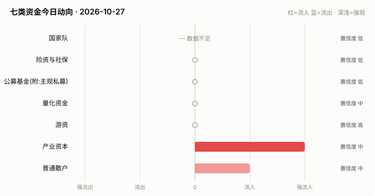
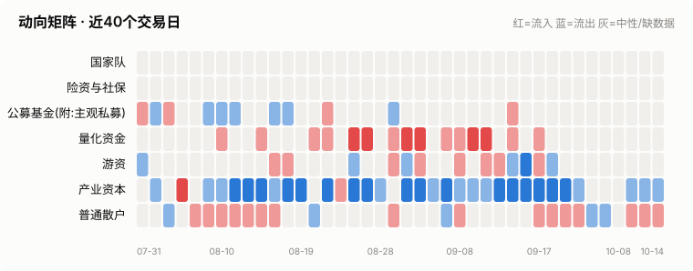
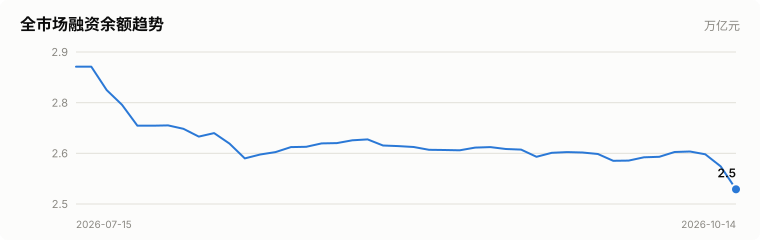
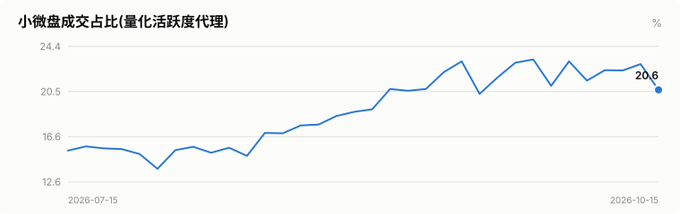
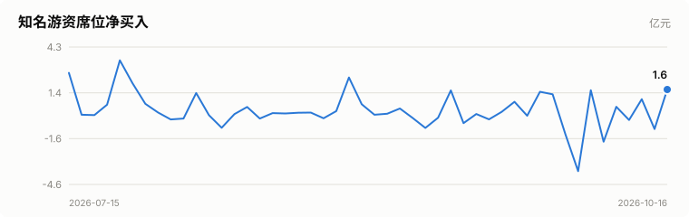
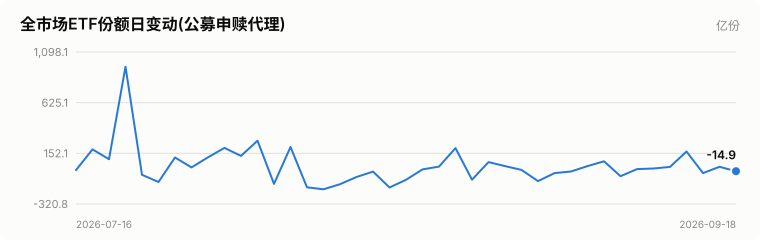
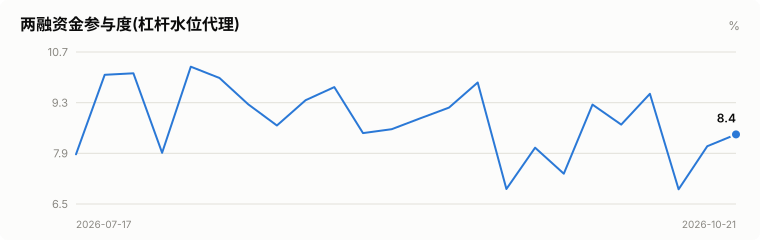

# A股资金动向日报 · 2026-10-27

> 本报告由公开数据自动生成。**方向结论按数据可得性标注置信度**:
> 高=每日硬数据(龙虎榜/公告/两融);中=每日代理指标(行为推断);低=仅低频或间接证据。

> ⚠️ 数据质量提示:本次运行保留了可用字段;缺失字段不补零,备用/历史值不视为当日值。各节中的警告包含具体来源和数据截至日期。

## 一、七类资金动向总览

| 参与者 | 动向 | 置信度 | 一句话解读 |
| --- | --- | --- | --- |
| 国家队 | — 数据不足 | 低 | ETF数据缺失,无法判断。 |
| 险资与社保 | → 中性 | 低 | 无涉险资/社保公告;险资无每日数据,默认视为中性。 |
| 公募基金(附:主观私募) | → 中性 | 低 | ETF份额环比待历史累积;近7天新发权益基金 7亿份。 |
| 量化资金 | — 数据不足 | 低 | 指数数据缺失,无法计算小微盘成交占比。 |
| 游资 | — 数据不足 | 低 | 龙虎榜数据缺失。 |
| 产业资本 | ↑↑ 大幅流入 | 中 | 净增持家数 +7;回购公告 20 家。 |
| 普通散户 | → 中性 | 中 | 小单净流入 +484亿;沪市融资余额环比 -96亿。 |

**历史趋势(随每日运行更新)**

## 二、分项明细

### 2.1 国家队 — — 数据不足(置信度:低)

> ⚠️ ETF快照数据缺失,本节无法判断。

### 2.2 险资与社保 — → 中性(置信度:低)

- 当日扫描持股变动公告 10 条,未发现涉险资/社保/举牌关键词。

> ⚠️ 险资/社保没有每日持仓披露:硬数据仅有季报十大流通股东与举牌公告,本节结论置信度恒为低,建议结合季报数据人工复核。

### 2.3 公募基金(附:主观私募) — → 中性(置信度:低)

- 近7天新成立权益类基金 8 只,合计募集 6.7亿份(反映公募增量资金入场节奏)。

**近7天新成立权益基金(募集前5)**

| 基金代码 | 基金简称 | 基金类型 | 募集份额 | 成立日期 |
| --- | --- | --- | --- | --- |
| 026952 | 广发恒指港股通ETF联接A | 指数型-股票 | 3.0 | 2026-10-20 |
| 026953 | 广发恒指港股通ETF联接C | 指数型-股票 | 3.0 | 2026-10-20 |
| 028765 | 富国中证卫星产业ETF发起式联接C | 指数型-股票 | 0.13 | 2026-10-20 |
| 028764 | 富国中证卫星产业ETF发起式联接A | 指数型-股票 | 0.13 | 2026-10-20 |
| 028931 | 广发中证有色金属矿业主题ETF发起式联接C | 指数型-股票 | 0.12 | 2026-10-20 |

> ⚠️ ETF实时快照接口今日不可用。
> ⚠️ 主观私募无每日公开持仓/仓位数据,通常仅有第三方月频仓位调查;本报告不对主观私募单独给出每日方向判断。

### 2.4 量化资金 — — 数据不足(置信度:低)

> ⚠️ 指数行情缺失:中证2000、上证综指、深证综指,量化活跃度无法计算。
> ⚠️ 量化动向为代理推断:公开数据无法区分具体量化策略,仅反映小微盘交易活跃度整体变化。

### 2.5 游资 — — 数据不足(置信度:低)

> ⚠️ 龙虎榜个股明细接口今日不可用。
> ⚠️ 活跃营业部接口今日不可用,席位识别缺失。

### 2.6 产业资本 — ↑↑ 大幅流入(置信度:中)

- 当日增持公告 7 家,减持公告 0 家,净增持家数 +7。
- 当日更新回购公告 20 家,披露已回购金额合计 9.3亿。

> ⚠️ 股东增减持计数采用stock_notice_report 持股变动公告代理(非精确股东变动明细),数据截至 2026-10-27(报告日期 2026-10-27)。
> ⚠️ 大宗交易市场统计尚未更新到当日。
> ⚠️ 大宗交易个股明细接口今日不可用。

### 2.7 普通散户 — → 中性(置信度:中)

- 全市场融资余额约 23948亿(沪 12374亿 + 深 11575亿),沪市环比 -95.9亿。
- 全市场小单(散户)净流入合计 483.8亿、主力净流入合计 -635.3亿(小单流入而主力流出,通常是散户接盘特征)(口径:历史资金流快照)。
- 最近披露月份(2023-08)新增投资者 99.59 万户,环比 +9.4%(月频指标;该月度口径中登公司已停止披露,仅作历史参考)。

> ⚠️ 沪市融资余额采用stock_margin_sse,数据截至 2026-10-23(报告日期 2026-10-27,滞后 4 个日历日)。
> ⚠️ 沪市融资买入额采用stock_margin_sse,数据截至 2026-10-23(报告日期 2026-10-27,滞后 4 个日历日)。
> ⚠️ 深市融资余额采用stock_margin_szse,数据截至 2026-10-23(报告日期 2026-10-27,滞后 4 个日历日)。
> ⚠️ 深市融资买入额采用stock_margin_szse,数据截至 2026-10-23(报告日期 2026-10-27,滞后 4 个日历日)。
> ⚠️ 资金流采用历史资金流快照,数据截至 2026-10-23(报告日期 2026-10-27,滞后 4 个日历日)。

## 三、个股杠杆监测

- 国家队(汇金系宽基ETF)历来是现金申购,不使用融资杠杆,因此没有可比的每日"国家队杠杆"数字;下面的杠杆水位与排行反映的主要是散户与游资的两融行为。
- 截至 2026-10-22纳入统计的3227只个股中,296只融资余额占流通市值超过8%(阈值见 config.yaml);建议持有这类个股时使用更紧的止损比例(参考仓位/止损计算器,该工具支持按代码查询个股杠杆水位)。

**个股杠杆最集中(前15只,2026-10-22两融数据，历史快照)**

| 代码 | 名称 | 融资买入占成交额% | 融资余额占流通市值% | 当日涨跌幅% | 当日振幅% |
| --- | --- | --- | --- | --- | --- |
| 600503 | 华丽家族 | 27.5 | 6.99 | 5.16 | 9.39 |
| 000928 | 中钢国际 | 27.28 | 3.91 | 1.86 | 4.27 |
| 600976 | 健民集团 | 26.79 | 4.32 | 1.69 | 3.84 |
| 002307 | 北新路桥 | 26.52 | 8.19 | 2.06 | 11.5 |
| 688566 | 吉贝尔 | 25.57 | 3.93 | 0.38 | 2.26 |
| 688056 | 莱伯泰科 | 25.55 | 3.3 | 8.91 | 17.01 |
| 600838 | 上海九百 | 24.04 | 3.54 | 10.0 | 0.0 |
| 300909 | 汇创达 | 22.17 | 9.6 | 4.25 | 9.76 |
| 002936 | 郑州银行 | 21.95 | 3.66 | 0.59 | 1.78 |
| 600157 | 永泰能源 | 20.48 | 4.22 | 1.46 | 5.11 |
| 002941 | 新疆交建 | 20.25 | 3.83 | 1.06 | 3.58 |
| 300099 | 尤洛卡 | 19.68 | 9.79 | -1.85 | 7.89 |
| 600512 | 腾达建设 | 19.41 | 8.02 | 0.5 | 3.98 |
| 600325 | 华发股份 | 18.96 | 7.19 | 0.4 | 3.56 |
| 688237 | 超卓航科 | 18.6 | 2.48 | 0.22 | 6.09 |

> ⚠️ 缺失:沪市成交额、深市成交额,市场整体杠杆水位无法计算。
> ⚠️ 个股杠杆排行采用本地历史快照,数据截至 2026-10-22(报告日期 2026-10-27,滞后 5 个日历日)。

## 四、数据说明与局限

- 国家队动向为行为推断(宽基ETF放量+指数走势组合),非官方口径;确认需等季报十大股东。
- 险资/社保、主观私募无每日公开数据,相关结论置信度恒为低。
- 量化动向以小微盘成交占比为代理,只反映整体活跃度,无法区分具体策略。
- 游资识别依赖 config.yaml 中的席位关键词表,存在漏配;拉萨系席位计为散户通道。
- 两融、龙虎榜等数据为 T+1 或盘后披露,个别接口更新时间不一。
- 个股杠杆排行剔除了流通市值过小的个股(阈值见 config.yaml),融资余额/买入额与当日行情存在披露时点差异,仅作参考,不构成个股推荐。
> ⚠️ 本报告含缺失、备用或历史快照数据;每条降级数字均按“数据截至 YYYY-MM-DD”标注真实新鲜度。

**本次运行的数据质量明细:**
- 国家队: ETF快照数据缺失,本节无法判断。
- 公募基金(附:主观私募): ETF实时快照接口今日不可用。
- 量化资金: 指数行情缺失:中证2000、上证综指、深证综指,量化活跃度无法计算。
- 游资: 龙虎榜个股明细接口今日不可用。
- 游资: 活跃营业部接口今日不可用,席位识别缺失。
- 产业资本: 股东增减持计数采用stock_notice_report 持股变动公告代理(非精确股东变动明细),数据截至 2026-10-27(报告日期 2026-10-27)。
- 产业资本: 大宗交易市场统计尚未更新到当日。
- 产业资本: 大宗交易个股明细接口今日不可用。
- 普通散户: 沪市融资余额采用stock_margin_sse,数据截至 2026-10-23(报告日期 2026-10-27,滞后 4 个日历日)。
- 普通散户: 沪市融资买入额采用stock_margin_sse,数据截至 2026-10-23(报告日期 2026-10-27,滞后 4 个日历日)。
- 普通散户: 深市融资余额采用stock_margin_szse,数据截至 2026-10-23(报告日期 2026-10-27,滞后 4 个日历日)。
- 普通散户: 深市融资买入额采用stock_margin_szse,数据截至 2026-10-23(报告日期 2026-10-27,滞后 4 个日历日)。
- 普通散户: 资金流采用历史资金流快照,数据截至 2026-10-23(报告日期 2026-10-27,滞后 4 个日历日)。
- 个股杠杆监测: 缺失:沪市成交额、深市成交额,市场整体杠杆水位无法计算。
- 个股杠杆监测: 个股杠杆排行采用本地历史快照,数据截至 2026-10-22(报告日期 2026-10-27,滞后 5 个日历日)。

**本次运行失败的数据源:**
- fund_etf_spot_em: HTTPError: 502 Server Error: Bad Gateway for url: https://push2delay.eastmoney.com/api/qt/clist/get?pn=1&pz=100&po=1&np=1&ut=bd1d9d
- stock_sse_deal_daily: ValueError: Length mismatch: Expected axis has 1 elements, new values have 6 elements
- stock_szse_summary: AttributeError: 'float' object has no attribute 'replace'
- stock_lhb_detail_em: TypeError: 'NoneType' object is not subscriptable
- stock_lhb_hyyyb_em: TypeError: 'NoneType' object is not subscriptable
- stock_ggcg_em: TimeoutError: 
- stock_ggcg_em: TimeoutError: 
- stock_dzjy_mrmx: TypeError: 'NoneType' object is not subscriptable
- stock_margin_szse: ValueError: Length mismatch: Expected axis has 0 elements, new values have 6 elements
- stock_margin_szse: ValueError: Length mismatch: Expected axis has 0 elements, new values have 6 elements
- stock_margin_szse: ValueError: Length mismatch: Expected axis has 0 elements, new values have 6 elements
- stock_margin_szse: ValueError: Length mismatch: Expected axis has 0 elements, new values have 6 elements
- stock_individual_fund_flow_rank: JSONDecodeError: Expecting value: line 1 column 1 (char 0)
- stock_market_fund_flow: ConnectionError: ('Connection aborted.', RemoteDisconnected('Remote end closed connection without response'))
- stock_margin_detail_sse: ValueError: Length mismatch: Expected axis has 0 elements, new values have 13 elements
- stock_margin_detail_sse: ValueError: Length mismatch: Expected axis has 0 elements, new values have 13 elements
- stock_margin_detail_sse: ValueError: Length mismatch: Expected axis has 0 elements, new values have 13 elements
- stock_margin_detail_sse: ValueError: Length mismatch: Expected axis has 0 elements, new values have 13 elements
- stock_zh_a_spot_em: ConnectionError: ('Connection aborted.', RemoteDisconnected('Remote end closed connection without response'))
