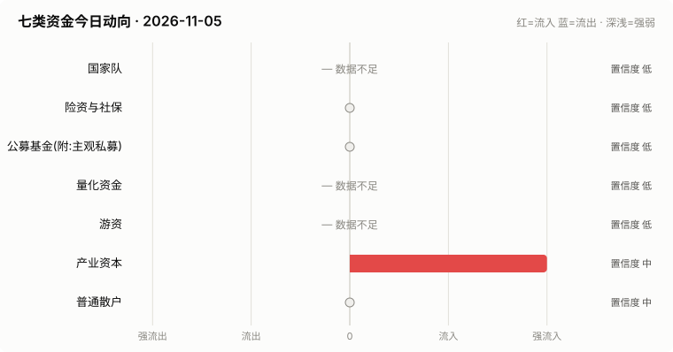
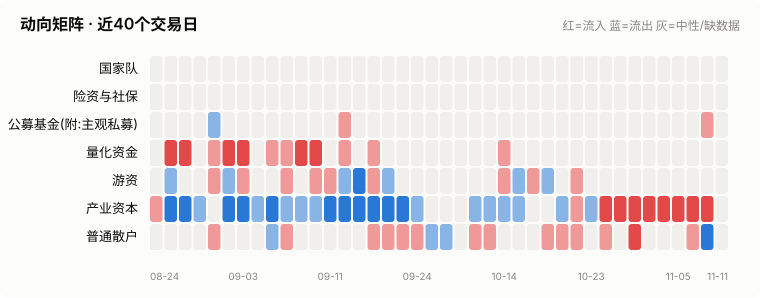
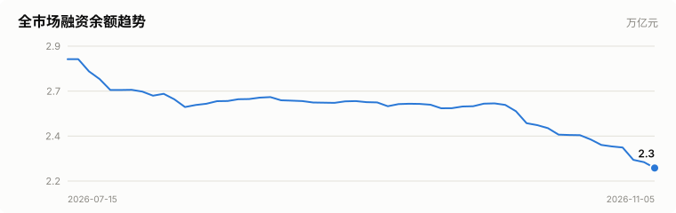
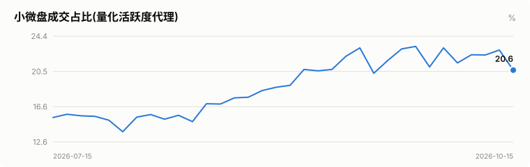
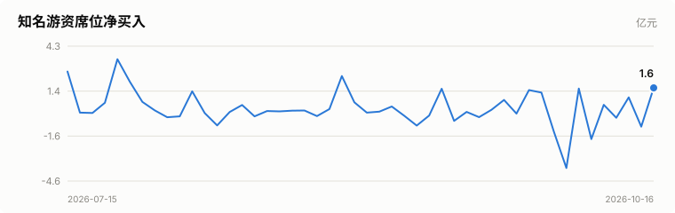
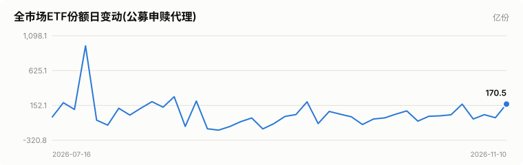
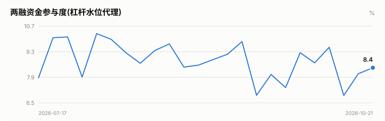

# A股资金动向日报 · 2026-11-05

> 本报告由公开数据自动生成。**方向结论按数据可得性标注置信度**:
> 高=每日硬数据(龙虎榜/公告/两融);中=每日代理指标(行为推断);低=仅低频或间接证据。

> ⚠️ 数据质量提示:本次运行保留了可用字段;缺失字段不补零,备用/历史值不视为当日值。各节中的警告包含具体来源和数据截至日期。

## 一、七类资金动向总览

| 参与者 | 动向 | 置信度 | 一句话解读 |
| --- | --- | --- | --- |
| 国家队 | — 数据不足 | 低 | ETF数据缺失,无法判断。 |
| 险资与社保 | → 中性 | 低 | 无涉险资/社保公告;险资无每日数据,默认视为中性。 |
| 公募基金(附:主观私募) | → 中性 | 低 | ETF份额环比待历史累积;近7天新发权益基金 8亿份。 |
| 量化资金 | — 数据不足 | 低 | 指数数据缺失,无法计算小微盘成交占比。 |
| 游资 | — 数据不足 | 低 | 龙虎榜数据缺失。 |
| 产业资本 | ↑↑ 大幅流入 | 中 | 净增持家数 +13;回购公告 27 家。 |
| 普通散户 | → 中性 | 中 | 小单净流入 +480亿;沪市融资余额环比 -156亿。 |

**历史趋势(随每日运行更新)**

## 二、分项明细

### 2.1 国家队 — — 数据不足(置信度:低)

> ⚠️ ETF快照数据缺失,本节无法判断。

### 2.2 险资与社保 — → 中性(置信度:低)

- 当日扫描持股变动公告 16 条,未发现涉险资/社保/举牌关键词。

> ⚠️ 险资/社保没有每日持仓披露:硬数据仅有季报十大流通股东与举牌公告,本节结论置信度恒为低,建议结合季报数据人工复核。

### 2.3 公募基金(附:主观私募) — → 中性(置信度:低)

- 近7天新成立权益类基金 4 只,合计募集 7.7亿份(反映公募增量资金入场节奏)。

**近7天新成立权益基金(募集前5)**

| 基金代码 | 基金简称 | 基金类型 | 募集份额 | 成立日期 |
| --- | --- | --- | --- | --- |
| 026921 | 天弘中证港股通互联网指数C | 指数型-股票 | 3.76 | 2026-10-30 |
| 026920 | 天弘中证港股通互联网指数A | 指数型-股票 | 3.76 | 2026-10-30 |
| 029286 | 鑫元先进制造睿选混合发起式A | 混合型-偏股 | 0.1 | 2026-10-29 |
| 029287 | 鑫元先进制造睿选混合发起式C | 混合型-偏股 | 0.1 | 2026-10-29 |

> ⚠️ ETF实时快照接口今日不可用。
> ⚠️ 主观私募无每日公开持仓/仓位数据,通常仅有第三方月频仓位调查;本报告不对主观私募单独给出每日方向判断。

### 2.4 量化资金 — — 数据不足(置信度:低)

> ⚠️ 指数行情缺失:中证2000、上证综指、深证综指,量化活跃度无法计算。
> ⚠️ 量化动向为代理推断:公开数据无法区分具体量化策略,仅反映小微盘交易活跃度整体变化。

### 2.5 游资 — — 数据不足(置信度:低)

> ⚠️ 龙虎榜个股明细接口今日不可用。
> ⚠️ 活跃营业部接口今日不可用,席位识别缺失。

### 2.6 产业资本 — ↑↑ 大幅流入(置信度:中)

- 当日增持公告 13 家,减持公告 0 家,净增持家数 +13。
- 当日更新回购公告 27 家,披露已回购金额合计 4.5亿。

> ⚠️ 股东增减持计数采用stock_notice_report 持股变动公告代理(非精确股东变动明细),数据截至 2026-11-05(报告日期 2026-11-05)。
> ⚠️ 大宗交易市场统计尚未更新到当日。
> ⚠️ 大宗交易个股明细接口今日不可用。

### 2.7 普通散户 — → 中性(置信度:中)

- 全市场融资余额约 22630亿(沪 11766亿 + 深 10864亿),沪市环比 -156.3亿。
- 全市场小单(散户)净流入合计 480.2亿、主力净流入合计 -571.4亿(小单流入而主力流出,通常是散户接盘特征)(口径:历史资金流快照)。
- 最近披露月份(2023-08)新增投资者 99.59 万户,环比 +9.4%(月频指标;该月度口径中登公司已停止披露,仅作历史参考)。

> ⚠️ 沪市融资余额采用stock_margin_sse,数据截至 2026-11-03(报告日期 2026-11-05,滞后 2 个日历日)。
> ⚠️ 沪市融资买入额采用stock_margin_sse,数据截至 2026-11-03(报告日期 2026-11-05,滞后 2 个日历日)。
> ⚠️ 深市融资余额采用stock_margin_szse,数据截至 2026-11-03(报告日期 2026-11-05,滞后 2 个日历日)。
> ⚠️ 深市融资买入额采用stock_margin_szse,数据截至 2026-11-03(报告日期 2026-11-05,滞后 2 个日历日)。
> ⚠️ 资金流采用历史资金流快照,数据截至 2026-11-04(报告日期 2026-11-05,滞后 1 个日历日)。

## 三、个股杠杆监测

- 国家队(汇金系宽基ETF)历来是现金申购,不使用融资杠杆,因此没有可比的每日"国家队杠杆"数字;下面的杠杆水位与排行反映的主要是散户与游资的两融行为。
- 当日纳入统计的3200只个股中,293只融资余额占流通市值超过8%(阈值见 config.yaml);建议持有这类个股时使用更紧的止损比例(参考仓位/止损计算器,该工具支持按代码查询个股杠杆水位)。

**个股杠杆最集中(前15只,2026-11-03两融数据)**

| 代码 | 名称 | 融资买入占成交额% | 融资余额占流通市值% | 当日涨跌幅% | 当日振幅% |
| --- | --- | --- | --- | --- | --- |
| 002275 | 桂林三金 | 35.6 | 2.98 | 10.0 | 14.3 |
| 002662 | 峰璟股份 | 34.48 | 7.93 | 0.35 | 3.14 |
| 603527 | 众源新材 | 33.81 | 5.28 | 3.22 | 4.95 |
| 600575 | 淮河能源 | 27.93 | 2.34 | -0.31 | 2.52 |
| 301168 | 通灵股份 | 27.04 | 8.88 | 0.9 | 3.0 |
| 301367 | 瑞迈特 | 26.31 | 4.19 | 1.85 | 3.01 |
| 603567 | 珍宝岛 | 26.17 | 4.06 | 0.82 | 5.1 |
| 001380 | 华纬科技 | 25.94 | 3.29 | 1.06 | 2.55 |
| 600221 | 海航控股 | 24.62 | 1.74 | 1.67 | 2.5 |
| 600218 | 全柴动力 | 24.18 | 9.37 | 2.01 | 4.17 |
| 601665 | 齐鲁银行 | 23.73 | 3.51 | 2.07 | 3.5 |
| 688075 | 安旭生物 | 22.9 | 2.59 | 1.99 | 2.24 |
| 301007 | 德迈仕 | 22.83 | 10.13 | 3.49 | 6.94 |
| 002033 | 丽江股份 | 22.45 | 4.09 | 0.12 | 0.96 |
| 688633 | 星球石墨 | 20.88 | 5.37 | 3.4 | 4.67 |

> ⚠️ 缺失:沪市成交额、深市成交额,市场整体杠杆水位无法计算。
> ⚠️ 实时行情快照主源不可用,本次排行采用腾讯备用源(数据截至 2026-11-05)。

## 四、数据说明与局限

- 国家队动向为行为推断(宽基ETF放量+指数走势组合),非官方口径;确认需等季报十大股东。
- 险资/社保、主观私募无每日公开数据,相关结论置信度恒为低。
- 量化动向以小微盘成交占比为代理,只反映整体活跃度,无法区分具体策略。
- 游资识别依赖 config.yaml 中的席位关键词表,存在漏配;拉萨系席位计为散户通道。
- 两融、龙虎榜等数据为 T+1 或盘后披露,个别接口更新时间不一。
- 个股杠杆排行剔除了流通市值过小的个股(阈值见 config.yaml),融资余额/买入额与当日行情存在披露时点差异,仅作参考,不构成个股推荐。
> ⚠️ 本报告含缺失、备用或历史快照数据;每条降级数字均按“数据截至 YYYY-MM-DD”标注真实新鲜度。

**本次运行的数据质量明细:**
- 国家队: ETF快照数据缺失,本节无法判断。
- 公募基金(附:主观私募): ETF实时快照接口今日不可用。
- 量化资金: 指数行情缺失:中证2000、上证综指、深证综指,量化活跃度无法计算。
- 游资: 龙虎榜个股明细接口今日不可用。
- 游资: 活跃营业部接口今日不可用,席位识别缺失。
- 产业资本: 股东增减持计数采用stock_notice_report 持股变动公告代理(非精确股东变动明细),数据截至 2026-11-05(报告日期 2026-11-05)。
- 产业资本: 大宗交易市场统计尚未更新到当日。
- 产业资本: 大宗交易个股明细接口今日不可用。
- 普通散户: 沪市融资余额采用stock_margin_sse,数据截至 2026-11-03(报告日期 2026-11-05,滞后 2 个日历日)。
- 普通散户: 沪市融资买入额采用stock_margin_sse,数据截至 2026-11-03(报告日期 2026-11-05,滞后 2 个日历日)。
- 普通散户: 深市融资余额采用stock_margin_szse,数据截至 2026-11-03(报告日期 2026-11-05,滞后 2 个日历日)。
- 普通散户: 深市融资买入额采用stock_margin_szse,数据截至 2026-11-03(报告日期 2026-11-05,滞后 2 个日历日)。
- 普通散户: 资金流采用历史资金流快照,数据截至 2026-11-04(报告日期 2026-11-05,滞后 1 个日历日)。
- 个股杠杆监测: 缺失:沪市成交额、深市成交额,市场整体杠杆水位无法计算。
- 个股杠杆监测: 实时行情快照主源不可用,本次排行采用腾讯备用源(数据截至 2026-11-05)。

**本次运行失败的数据源:**
- fund_etf_spot_em: HTTPError: 502 Server Error: Bad Gateway for url: https://push2delay.eastmoney.com/api/qt/clist/get?pn=1&pz=100&po=1&np=1&ut=bd1d9d
- stock_sse_deal_daily: ValueError: Length mismatch: Expected axis has 1 elements, new values have 6 elements
- stock_szse_summary: AttributeError: 'float' object has no attribute 'replace'
- stock_lhb_detail_em: TypeError: 'NoneType' object is not subscriptable
- stock_lhb_hyyyb_em: TypeError: 'NoneType' object is not subscriptable
- stock_ggcg_em: TimeoutError: 
- stock_ggcg_em: ChunkedEncodingError: Response ended prematurely
- stock_dzjy_mrmx: TypeError: 'NoneType' object is not subscriptable
- stock_margin_szse: ValueError: Length mismatch: Expected axis has 0 elements, new values have 6 elements
- stock_margin_szse: ValueError: Length mismatch: Expected axis has 0 elements, new values have 6 elements
- stock_individual_fund_flow_rank: JSONDecodeError: Expecting value: line 1 column 1 (char 0)
- stock_market_fund_flow: Push2RateLimitError: 东方财富 push2 行情服务器断开了连接，通常是短时间内请求过多，当前 IP 被临时限流。首次限流一般约 5 分钟后恢复，反复触发后可能需要 40 分钟以上；等待期间不要重复调用东方财富的行情接口，否则会延长限流。
- stock_margin_detail_sse: ValueError: Length mismatch: Expected axis has 0 elements, new values have 13 elements
- stock_margin_detail_sse: ValueError: Length mismatch: Expected axis has 0 elements, new values have 13 elements
- stock_zh_a_spot_em: Push2RateLimitError: 东方财富 push2 行情服务器断开了连接，通常是短时间内请求过多，当前 IP 被临时限流。首次限流一般约 5 分钟后恢复，反复触发后可能需要 40 分钟以上；等待期间不要重复调用东方财富的行情接口，否则会延长限流。
