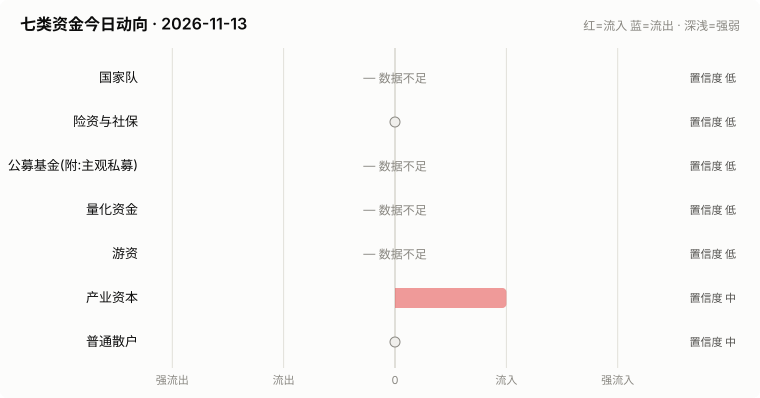
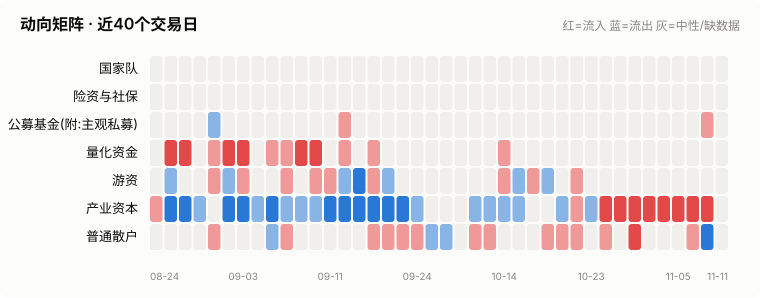
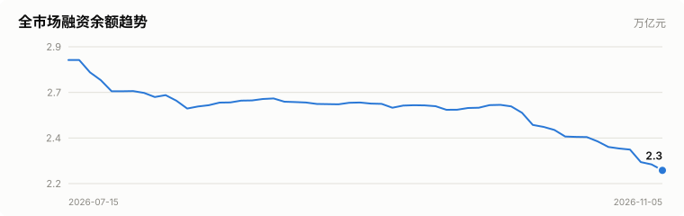
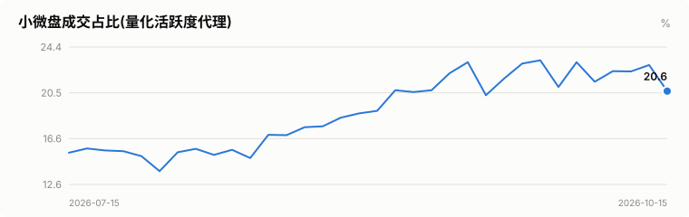
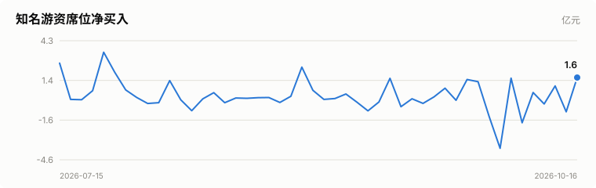
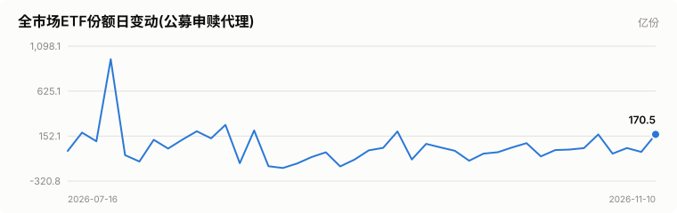
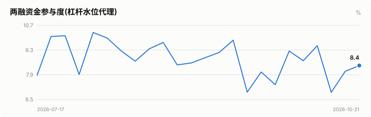

# A股资金动向日报 · 2026-11-13

> 本报告由公开数据自动生成。**方向结论按数据可得性标注置信度**:
> 高=每日硬数据(龙虎榜/公告/两融);中=每日代理指标(行为推断);低=仅低频或间接证据。

> ⚠️ 数据质量提示:本次运行保留了可用字段;缺失字段不补零,备用/历史值不视为当日值。各节中的警告包含具体来源和数据截至日期。

## 一、七类资金动向总览

| 参与者 | 动向 | 置信度 | 一句话解读 |
| --- | --- | --- | --- |
| 国家队 | — 数据不足 | 低 | ETF数据缺失,无法判断。 |
| 险资与社保 | → 中性 | 低 | 无涉险资/社保公告;险资无每日数据,默认视为中性。 |
| 公募基金(附:主观私募) | — 数据不足 | 低 | 数据不足。 |
| 量化资金 | — 数据不足 | 低 | 指数数据缺失,无法计算小微盘成交占比。 |
| 游资 | — 数据不足 | 低 | 龙虎榜数据缺失。 |
| 产业资本 | ↑ 流入 | 中 | 净增持家数 +5;回购公告 21 家。 |
| 普通散户 | → 中性 | 中 | 小单净流入 +423亿;沪市融资余额环比 -38亿。 |

**历史趋势(随每日运行更新)**

## 二、分项明细

### 2.1 国家队 — — 数据不足(置信度:低)

> ⚠️ ETF快照数据缺失,本节无法判断。

### 2.2 险资与社保 — → 中性(置信度:低)

- 当日扫描持股变动公告 7 条,未发现涉险资/社保/举牌关键词。

> ⚠️ 险资/社保没有每日持仓披露:硬数据仅有季报十大流通股东与举牌公告,本节结论置信度恒为低,建议结合季报数据人工复核。

### 2.3 公募基金(附:主观私募) — — 数据不足(置信度:低)

- 近7天新成立权益类基金 0 只,合计募集 0.0亿份(反映公募增量资金入场节奏)。

> ⚠️ ETF实时快照接口今日不可用。
> ⚠️ 主观私募无每日公开持仓/仓位数据,通常仅有第三方月频仓位调查;本报告不对主观私募单独给出每日方向判断。

### 2.4 量化资金 — — 数据不足(置信度:低)

> ⚠️ 指数行情缺失:中证2000、上证综指、深证综指,量化活跃度无法计算。
> ⚠️ 量化动向为代理推断:公开数据无法区分具体量化策略,仅反映小微盘交易活跃度整体变化。

### 2.5 游资 — — 数据不足(置信度:低)

> ⚠️ 龙虎榜个股明细接口今日不可用。
> ⚠️ 活跃营业部接口今日不可用,席位识别缺失。

### 2.6 产业资本 — ↑ 流入(置信度:中)

- 当日增持公告 6 家,减持公告 1 家,净增持家数 +5。
- 当日更新回购公告 21 家,披露已回购金额合计 18.4亿。

> ⚠️ 股东增减持计数采用stock_notice_report 持股变动公告代理(非精确股东变动明细),数据截至 2026-11-13(报告日期 2026-11-13)。
> ⚠️ 大宗交易市场统计尚未更新到当日。
> ⚠️ 大宗交易个股明细接口今日不可用。

### 2.7 普通散户 — → 中性(置信度:中)

- 全市场融资余额约 22633亿(沪 11744亿 + 深 10889亿),沪市环比 -38.0亿。
- 全市场小单(散户)净流入合计 423.3亿、主力净流入合计 -524.1亿(小单流入而主力流出,通常是散户接盘特征)(口径:大盘资金流接口(全市场代理))。
- 最近披露月份(2023-08)新增投资者 99.59 万户,环比 +9.4%(月频指标;该月度口径中登公司已停止披露,仅作历史参考)。

> ⚠️ 沪市融资余额采用历史两融快照,数据截至 2026-11-12(报告日期 2026-11-13,滞后 1 个日历日)。
> ⚠️ 沪市融资买入额采用历史两融快照,数据截至 2026-11-12(报告日期 2026-11-13,滞后 1 个日历日)。
> ⚠️ 深市融资余额采用stock_margin_szse,数据截至 2026-11-11(报告日期 2026-11-13,滞后 2 个日历日)。
> ⚠️ 深市融资买入额采用stock_margin_szse,数据截至 2026-11-11(报告日期 2026-11-13,滞后 2 个日历日)。
> ⚠️ 资金流采用大盘资金流接口(全市场代理),数据截至 2026-11-12(报告日期 2026-11-13,滞后 1 个日历日)。

## 三、个股杠杆监测

- 国家队(汇金系宽基ETF)历来是现金申购,不使用融资杠杆,因此没有可比的每日"国家队杠杆"数字;下面的杠杆水位与排行反映的主要是散户与游资的两融行为。
- 当日纳入统计的1653只个股中,181只融资余额占流通市值超过8%(阈值见 config.yaml);建议持有这类个股时使用更紧的止损比例(参考仓位/止损计算器,该工具支持按代码查询个股杠杆水位)。

**个股杠杆最集中(前15只,2026-11-11两融数据)**

| 代码 | 名称 | 融资买入占成交额% | 融资余额占流通市值% | 当日涨跌幅% | 当日振幅% |
| --- | --- | --- | --- | --- | --- |
| 300712 | 永福股份 | 37.64 | 5.17 | -2.1 | 2.82 |
| 002554 | 惠博普 | 31.05 | 4.77 | -0.78 | 2.75 |
| 002534 | 西子洁能 | 29.87 | 2.36 | -2.92 | 4.75 |
| 300885 | 海昌新材 | 24.09 | 5.1 | -3.86 | 3.86 |
| 301038 | 深水规院 | 23.75 | 1.92 | -1.47 | 2.48 |
| 000807 | 云铝股份 | 23.69 | 2.62 | -0.43 | 1.79 |
| 300018 | 中元股份 | 23.1 | 10.31 | -1.51 | 1.51 |
| 300409 | 道氏技术 | 23.0 | 9.26 | -3.91 | 4.05 |
| 000006 | 深振业Ａ | 22.35 | 7.48 | -2.22 | 3.16 |
| 002672 | 东江环保 | 22.17 | 2.79 | -0.29 | 1.47 |
| 002556 | 辉隆股份 | 22.1 | 6.5 | -0.92 | 1.84 |
| 300479 | 神思电子 | 22.1 | 6.43 | -3.44 | 4.56 |
| 301028 | 鼎熔岩 | 21.45 | 3.56 | -1.82 | 3.28 |
| 002532 | 天山铝业 | 21.16 | 2.2 | 0.18 | 1.77 |
| 002303 | 美盈森 | 20.95 | 6.76 | -1.22 | 3.05 |

> ⚠️ 缺失:沪市成交额、深市成交额,市场整体杠杆水位无法计算。
> ⚠️ 实时行情快照主源不可用,本次排行采用腾讯备用源(数据截至 2026-11-13)。
> ⚠️ 个股两融明细缺失沪市,排行仅使用可用市场明细(数据截至 2026-11-11)。

## 四、数据说明与局限

- 国家队动向为行为推断(宽基ETF放量+指数走势组合),非官方口径;确认需等季报十大股东。
- 险资/社保、主观私募无每日公开数据,相关结论置信度恒为低。
- 量化动向以小微盘成交占比为代理,只反映整体活跃度,无法区分具体策略。
- 游资识别依赖 config.yaml 中的席位关键词表,存在漏配;拉萨系席位计为散户通道。
- 两融、龙虎榜等数据为 T+1 或盘后披露,个别接口更新时间不一。
- 个股杠杆排行剔除了流通市值过小的个股(阈值见 config.yaml),融资余额/买入额与当日行情存在披露时点差异,仅作参考,不构成个股推荐。
> ⚠️ 本报告含缺失、备用或历史快照数据;每条降级数字均按“数据截至 YYYY-MM-DD”标注真实新鲜度。

**本次运行的数据质量明细:**
- 国家队: ETF快照数据缺失,本节无法判断。
- 公募基金(附:主观私募): ETF实时快照接口今日不可用。
- 量化资金: 指数行情缺失:中证2000、上证综指、深证综指,量化活跃度无法计算。
- 游资: 龙虎榜个股明细接口今日不可用。
- 游资: 活跃营业部接口今日不可用,席位识别缺失。
- 产业资本: 股东增减持计数采用stock_notice_report 持股变动公告代理(非精确股东变动明细),数据截至 2026-11-13(报告日期 2026-11-13)。
- 产业资本: 大宗交易市场统计尚未更新到当日。
- 产业资本: 大宗交易个股明细接口今日不可用。
- 普通散户: 沪市融资余额采用历史两融快照,数据截至 2026-11-12(报告日期 2026-11-13,滞后 1 个日历日)。
- 普通散户: 沪市融资买入额采用历史两融快照,数据截至 2026-11-12(报告日期 2026-11-13,滞后 1 个日历日)。
- 普通散户: 深市融资余额采用stock_margin_szse,数据截至 2026-11-11(报告日期 2026-11-13,滞后 2 个日历日)。
- 普通散户: 深市融资买入额采用stock_margin_szse,数据截至 2026-11-11(报告日期 2026-11-13,滞后 2 个日历日)。
- 普通散户: 资金流采用大盘资金流接口(全市场代理),数据截至 2026-11-12(报告日期 2026-11-13,滞后 1 个日历日)。
- 个股杠杆监测: 缺失:沪市成交额、深市成交额,市场整体杠杆水位无法计算。
- 个股杠杆监测: 实时行情快照主源不可用,本次排行采用腾讯备用源(数据截至 2026-11-13)。
- 个股杠杆监测: 个股两融明细缺失沪市,排行仅使用可用市场明细(数据截至 2026-11-11)。

**本次运行失败的数据源:**
- stock_zh_index_hist_csindex: ConnectionError: ('Connection aborted.', ConnectionResetError(104, 'Connection reset by peer'))
- fund_etf_spot_em: HTTPError: 502 Server Error: Bad Gateway for url: https://push2delay.eastmoney.com/api/qt/clist/get?pn=1&pz=100&po=1&np=1&ut=bd1d9d
- stock_zh_index_hist_csindex: ConnectionError: ('Connection aborted.', ConnectionResetError(104, 'Connection reset by peer'))
- stock_sse_deal_daily: ConnectionError: HTTPSConnectionPool(host='query.sse.com.cn', port=443): Max retries exceeded with url: /commonQuery.do?sqlId=COMMON_SSE_
- stock_szse_summary: AttributeError: 'float' object has no attribute 'replace'
- stock_lhb_detail_em: TypeError: 'NoneType' object is not subscriptable
- stock_lhb_hyyyb_em: TypeError: 'NoneType' object is not subscriptable
- stock_ggcg_em: TimeoutError: 
- stock_ggcg_em: TimeoutError: 
- stock_dzjy_mrmx: TypeError: 'NoneType' object is not subscriptable
- stock_margin_sse: ConnectionError: HTTPSConnectionPool(host='query.sse.com.cn', port=443): Max retries exceeded with url: /marketdata/tradedata/queryMargin
- stock_margin_szse: ValueError: Length mismatch: Expected axis has 0 elements, new values have 6 elements
- stock_margin_szse: ValueError: Length mismatch: Expected axis has 0 elements, new values have 6 elements
- stock_individual_fund_flow_rank: JSONDecodeError: Expecting value: line 1 column 1 (char 0)
- stock_margin_detail_sse: ConnectionError: HTTPSConnectionPool(host='query.sse.com.cn', port=443): Max retries exceeded with url: /marketdata/tradedata/queryMargin
- stock_margin_detail_sse: ConnectionError: HTTPSConnectionPool(host='query.sse.com.cn', port=443): Max retries exceeded with url: /marketdata/tradedata/queryMargin
- stock_margin_detail_sse: ConnectionError: HTTPSConnectionPool(host='query.sse.com.cn', port=443): Max retries exceeded with url: /marketdata/tradedata/queryMargin
- stock_zh_a_spot_em: Push2RateLimitError: 东方财富 push2 行情服务器断开了连接，通常是短时间内请求过多，当前 IP 被临时限流。首次限流一般约 5 分钟后恢复，反复触发后可能需要 40 分钟以上；等待期间不要重复调用东方财富的行情接口，否则会延长限流。
- stock_zh_index_hist_csindex: ConnectionError: ('Connection aborted.', ConnectionResetError(104, 'Connection reset by peer'))
