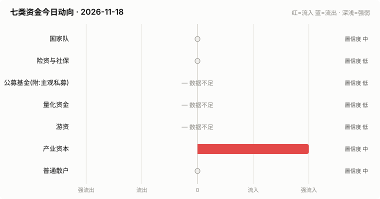
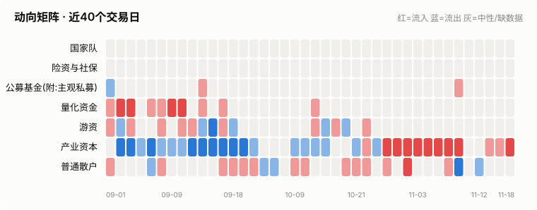
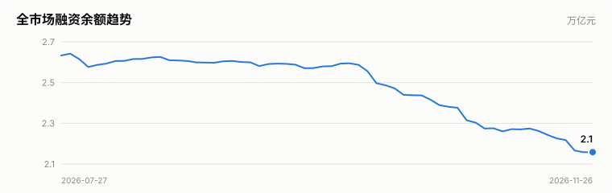
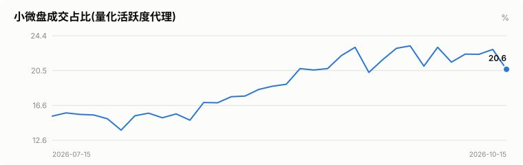
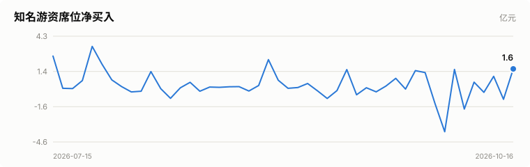
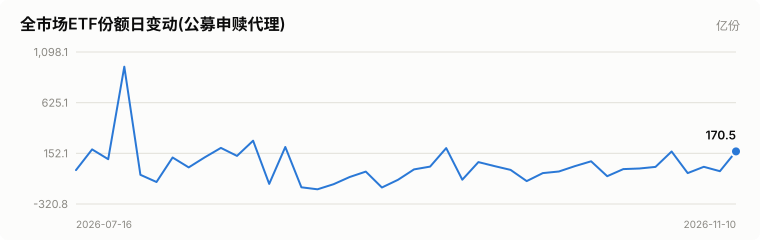
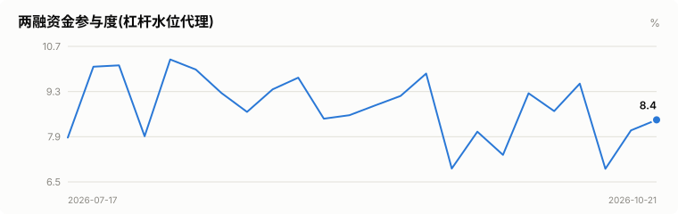

# A股资金动向日报 · 2026-11-18

> 本报告由公开数据自动生成。**方向结论按数据可得性标注置信度**:
> 高=每日硬数据(龙虎榜/公告/两融);中=每日代理指标(行为推断);低=仅低频或间接证据。

> ⚠️ 数据质量提示:本次运行保留了可用字段;缺失字段不补零,备用/历史值不视为当日值。各节中的警告包含具体来源和数据截至日期。

## 一、七类资金动向总览

| 参与者 | 动向 | 置信度 | 一句话解读 |
| --- | --- | --- | --- |
| 国家队 | → 中性 | 中 | 宽基ETF放量但指数不弱,更像市场自发交易,护盘证据不足。 |
| 险资与社保 | → 中性 | 低 | 无涉险资/社保公告;险资无每日数据,默认视为中性。 |
| 公募基金(附:主观私募) | — 数据不足 | 低 | 数据不足。 |
| 量化资金 | — 数据不足 | 低 | 指数数据缺失,无法计算小微盘成交占比。 |
| 游资 | — 数据不足 | 低 | 龙虎榜数据缺失。 |
| 产业资本 | ↑↑ 大幅流入 | 中 | 净增持家数 +13;回购公告 24 家。 |
| 普通散户 | → 中性 | 中 | 小单净流入 +423亿;沪市融资余额环比 -95亿。 |

**历史趋势(随每日运行更新)**

## 二、分项明细

### 2.1 国家队 — → 中性(置信度:中)

- 2 只宽基ETF显著放量但指数未大跌(-0.30%),更可能是市场自发交易活跃,护盘证据不足。

**汇金系宽基ETF当日成交**

| 代码 | 名称 | 当日成交额 | 相对20日均量 | 涨跌幅 |
| --- | --- | --- | --- | --- |
| 510300 | 华泰柏瑞沪深300ETF | 81.1亿 | 2.00x | -0.30% |
| 510050 | 华夏上证50ETF | 20.6亿 | 1.32x | -0.03% |
| 510500 | 南方中证500ETF | 40.9亿 | 1.14x | -0.27% |
| 159919 | 嘉实沪深300ETF | 26.6亿 | 3.16x | -0.26% |
| 588000 | 华夏科创50ETF | 97.7亿 | 1.36x | +0.94% |
| 512100 | 南方中证1000ETF | 50.7亿 | 1.50x | -1.36% |

> ⚠️ 沪深300指数行情不可用,以 510300 ETF 涨跌幅代理。

### 2.2 险资与社保 — → 中性(置信度:低)

- 当日扫描持股变动公告 15 条,未发现涉险资/社保/举牌关键词。

> ⚠️ 险资/社保没有每日持仓披露:硬数据仅有季报十大流通股东与举牌公告,本节结论置信度恒为低,建议结合季报数据人工复核。

### 2.3 公募基金(附:主观私募) — — 数据不足(置信度:低)

- 全市场ETF总份额较上一交易日变动 +nan亿份(净赎回),以此作为公募被动端申赎代理。
- 近7天新成立权益类基金 0 只,合计募集 0.0亿份(反映公募增量资金入场节奏)。

> ⚠️ 主观私募无每日公开持仓/仓位数据,通常仅有第三方月频仓位调查;本报告不对主观私募单独给出每日方向判断。

### 2.4 量化资金 — — 数据不足(置信度:低)

> ⚠️ 指数行情缺失:中证2000、上证综指、深证综指,量化活跃度无法计算。
> ⚠️ 量化动向为代理推断:公开数据无法区分具体量化策略,仅反映小微盘交易活跃度整体变化。

### 2.5 游资 — — 数据不足(置信度:低)

> ⚠️ 龙虎榜个股明细接口今日不可用。
> ⚠️ 活跃营业部接口今日不可用,席位识别缺失。

### 2.6 产业资本 — ↑↑ 大幅流入(置信度:中)

- 当日增持公告 13 家,减持公告 0 家,净增持家数 +13。
- 当日更新回购公告 24 家,披露已回购金额合计 7.6亿。

> ⚠️ 股东增减持计数采用stock_notice_report 持股变动公告代理(非精确股东变动明细),数据截至 2026-11-18(报告日期 2026-11-18)。
> ⚠️ 大宗交易市场统计尚未更新到当日。
> ⚠️ 大宗交易个股明细接口今日不可用。

### 2.7 普通散户 — → 中性(置信度:中)

- 全市场融资余额约 22284亿(沪 11598亿 + 深 10686亿),沪市环比 -94.5亿。
- 全市场小单(散户)净流入合计 423.3亿、主力净流入合计 -524.1亿(小单流入而主力流出,通常是散户接盘特征)(口径:历史资金流快照)。
- 最近披露月份(2023-08)新增投资者 99.59 万户,环比 +9.4%(月频指标;该月度口径中登公司已停止披露,仅作历史参考)。

> ⚠️ 沪市融资余额采用stock_margin_sse,数据截至 2026-11-16(报告日期 2026-11-18,滞后 2 个日历日)。
> ⚠️ 沪市融资买入额采用stock_margin_sse,数据截至 2026-11-16(报告日期 2026-11-18,滞后 2 个日历日)。
> ⚠️ 深市融资余额采用stock_margin_szse,数据截至 2026-11-16(报告日期 2026-11-18,滞后 2 个日历日)。
> ⚠️ 深市融资买入额采用stock_margin_szse,数据截至 2026-11-16(报告日期 2026-11-18,滞后 2 个日历日)。
> ⚠️ 资金流采用历史资金流快照,数据截至 2026-11-17(报告日期 2026-11-18,滞后 1 个日历日)。

## 三、个股杠杆监测

- 国家队(汇金系宽基ETF)历来是现金申购,不使用融资杠杆,因此没有可比的每日"国家队杠杆"数字;下面的杠杆水位与排行反映的主要是散户与游资的两融行为。
- 当日纳入统计的3181只个股中,342只融资余额占流通市值超过8%(阈值见 config.yaml);建议持有这类个股时使用更紧的止损比例(参考仓位/止损计算器,该工具支持按代码查询个股杠杆水位)。

**个股杠杆最集中(前15只,2026-11-16两融数据)**

| 代码 | 名称 | 融资买入占成交额% | 融资余额占流通市值% | 当日涨跌幅% | 当日振幅% |
| --- | --- | --- | --- | --- | --- |
| 603103 | 横店影视 | 74.79 | 0.59 | -10.0 | 3.0 |
| 688799 | 华纳药厂 | 32.69 | 5.01 | -2.84 | 4.85 |
| 688171 | 纬德信息 | 32.58 | 5.31 | -2.7 | 6.98 |
| 688084 | 晶品特装 | 28.7 | 5.2 | -4.27 | 6.21 |
| 301617 | 博苑新材 | 28.69 | 7.24 | -2.08 | 4.67 |
| 688690 | 纳微科技 | 28.31 | 2.85 | 0.17 | 4.12 |
| 688196 | 卓越新能 | 28.15 | 2.82 | -2.63 | 4.04 |
| 688230 | 芯导科技 | 27.86 | 3.76 | -0.69 | 4.99 |
| 601128 | 常熟银行 | 27.19 | 1.79 | -0.16 | 0.93 |
| 603609 | 禾丰股份 | 26.79 | 3.49 | -1.98 | 2.89 |
| 002685 | 华东重机 | 26.25 | 5.68 | 10.02 | 0.0 |
| 688765 | 禾元生物 | 26.03 | 3.85 | -3.44 | 5.2 |
| 603396 | 金辰股份 | 25.65 | 2.66 | -10.0 | 0.0 |
| 600201 | 生物股份 | 25.58 | 9.66 | -0.83 | 2.67 |
| 688456 | 有研粉材 | 25.32 | 7.26 | -0.28 | 7.72 |

> ⚠️ 缺失:沪市成交额、深市成交额,市场整体杠杆水位无法计算。
> ⚠️ 实时行情快照主源不可用,本次排行采用腾讯备用源(数据截至 2026-11-18)。

## 四、数据说明与局限

- 国家队动向为行为推断(宽基ETF放量+指数走势组合),非官方口径;确认需等季报十大股东。
- 险资/社保、主观私募无每日公开数据,相关结论置信度恒为低。
- 量化动向以小微盘成交占比为代理,只反映整体活跃度,无法区分具体策略。
- 游资识别依赖 config.yaml 中的席位关键词表,存在漏配;拉萨系席位计为散户通道。
- 两融、龙虎榜等数据为 T+1 或盘后披露,个别接口更新时间不一。
- 个股杠杆排行剔除了流通市值过小的个股(阈值见 config.yaml),融资余额/买入额与当日行情存在披露时点差异,仅作参考,不构成个股推荐。
> ⚠️ 本报告含缺失、备用或历史快照数据;每条降级数字均按“数据截至 YYYY-MM-DD”标注真实新鲜度。

**本次运行的数据质量明细:**
- 国家队: 沪深300指数行情不可用,以 510300 ETF 涨跌幅代理。
- 量化资金: 指数行情缺失:中证2000、上证综指、深证综指,量化活跃度无法计算。
- 游资: 龙虎榜个股明细接口今日不可用。
- 游资: 活跃营业部接口今日不可用,席位识别缺失。
- 产业资本: 股东增减持计数采用stock_notice_report 持股变动公告代理(非精确股东变动明细),数据截至 2026-11-18(报告日期 2026-11-18)。
- 产业资本: 大宗交易市场统计尚未更新到当日。
- 产业资本: 大宗交易个股明细接口今日不可用。
- 普通散户: 沪市融资余额采用stock_margin_sse,数据截至 2026-11-16(报告日期 2026-11-18,滞后 2 个日历日)。
- 普通散户: 沪市融资买入额采用stock_margin_sse,数据截至 2026-11-16(报告日期 2026-11-18,滞后 2 个日历日)。
- 普通散户: 深市融资余额采用stock_margin_szse,数据截至 2026-11-16(报告日期 2026-11-18,滞后 2 个日历日)。
- 普通散户: 深市融资买入额采用stock_margin_szse,数据截至 2026-11-16(报告日期 2026-11-18,滞后 2 个日历日)。
- 普通散户: 资金流采用历史资金流快照,数据截至 2026-11-17(报告日期 2026-11-18,滞后 1 个日历日)。
- 个股杠杆监测: 缺失:沪市成交额、深市成交额,市场整体杠杆水位无法计算。
- 个股杠杆监测: 实时行情快照主源不可用,本次排行采用腾讯备用源(数据截至 2026-11-18)。

**本次运行失败的数据源:**
- tool_trade_date_hist_sina(akshare 无此接口)
- stock_zh_index_hist_csindex(akshare 无此接口)
- stock_zh_index_hist_csindex(akshare 无此接口)
- stock_sse_deal_daily(akshare 无此接口)
- stock_szse_summary(akshare 无此接口)
- stock_lhb_detail_em: TypeError: 'NoneType' object is not subscriptable
- stock_lhb_hyyyb_em: TypeError: 'NoneType' object is not subscriptable
- stock_ggcg_em: TimeoutError: 
- stock_ggcg_em: TimeoutError: 
- stock_dzjy_mrmx: TypeError: 'NoneType' object is not subscriptable
- stock_margin_szse: ValueError: Length mismatch: Expected axis has 0 elements, new values have 6 elements
- stock_margin_szse: ValueError: Length mismatch: Expected axis has 0 elements, new values have 6 elements
- stock_individual_fund_flow_rank(akshare 无此接口)
- stock_market_fund_flow(akshare 无此接口)
- stock_margin_detail_sse: ValueError: Length mismatch: Expected axis has 0 elements, new values have 13 elements
- stock_margin_detail_sse: ValueError: Length mismatch: Expected axis has 0 elements, new values have 13 elements
- stock_zh_a_spot_em: TimeoutError: 
- stock_zh_index_hist_csindex(akshare 无此接口)
- stock_zh_index_daily(akshare 无此接口)
- stock_zh_index_daily_em(akshare 无此接口)
- stock_zh_index_daily(akshare 无此接口)
- stock_zh_index_daily_em(akshare 无此接口)
